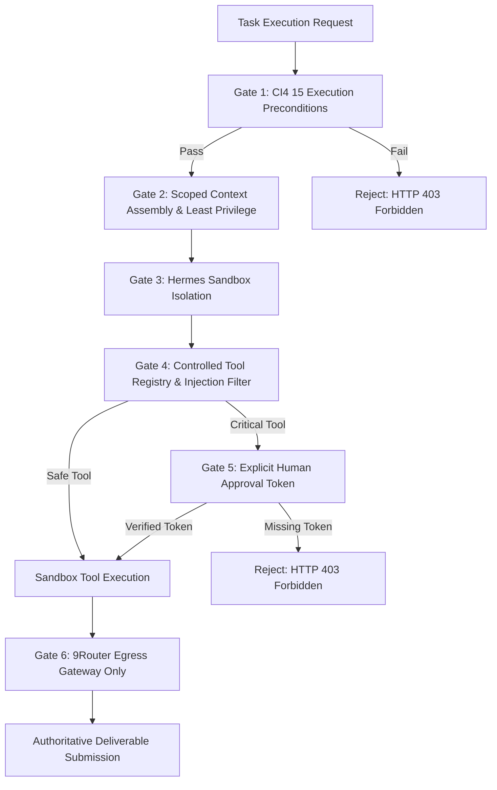

# AI Agent Execution Security & Guardrails

## 1. Threat Model & Security Boundaries

The MCE AI Office platform operates autonomous and semi-autonomous AI workforce agents. The execution security architecture is designed to prevent privilege escalation, unauthorized corporate commitments, prompt injection, and data exfiltration.

---

## 2. 15 Pre-Execution Verification Checks

Before CI4 dispatches any task to Hermes, `ExecutionAuthorizationService` strictly verifies all 15 preconditions:

1. **Task Existence**: Target task must exist in `workforce_tasks`.
2. **Task Executable State**: Task status must be `draft`, `ready`, `assigned`, `awaiting_acceptance`, `accepted`, or `in_progress`.
3. **Agent Existence & Active State**: Executing agent must exist and have `lifecycle_state === 'active'`.
4. **Task Assignment**: Agent must be the accountable agent or hold an active assignment in `task_assignments`.
5. **Assignment Acceptance**: Assignment status must be `accepted` or `proposed`.
6. **Agent Availability**: Agent must not have an approved leave or unavailability record in `workforce_agent_availability`.
7. **Schedule & Roster Policy**: Agent must not be scheduled on an off-duty rest day in `workforce_duty_assignments`.
8. **Required Skill Competency**: Agent must possess verified active proficiency in the task's required skill (`ai_agent_skills`).
9. **Delegation of Authority (DoA)**: Estimated task financial or risk impact must not exceed agent position's DoA autonomous limit (`governance_authority_profiles`).
10. **Runtime Identity Mapping**: Agent must have an active mapping in `ai_agent_runtime_mappings` with `integration_status === 'ready'`.
11. **Runtime Profile Binding**: Active runtime profile must exist in `runtime_profiles`.
12. **Model Routing Profile Binding**: Active 9Router profile must exist in `model_routing_profiles`.
13. **Active Hermes Environment**: Assigned Hermes runtime node must be reachable or in verified simulation fallback.
14. **Active 9Router Gateway**: 9Router gateway must be reachable or in verified simulation multiplexer mode.
15. **Idempotency Protection**: Execution nonce must not conflict with an active executing session.

---

## 3. Tool Authorization & Prompt Injection Mitigation

- **Registry Enforcement**: Agents can only invoke tools explicitly registered in `runtime_tools_registry`.
- **Input Sanitization**: `ToolAuthorizationService::sanitizeInput` strips HTML, script tags, control characters, and common shell injection payloads from tool input payloads.
- **Critical Risk Gate**: Tools with `risk_level === 'critical'` (e.g. `TOOL-DB-MUTATE`) require an explicit cryptographic human approval token (`approval_token`). Unauthenticated attempts are immediately rejected and logged as `rejected` in `runtime_tool_invocations`.
