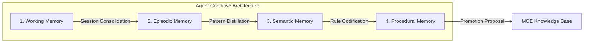
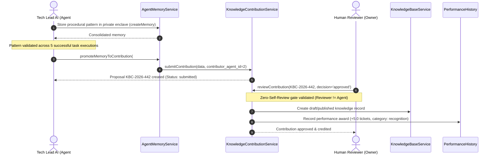

# MCE AI Agent Memory Architecture

**Document Reference:** `MCE-ARCH-AMA-025`  
**Version:** `1.0.0`  
**Classification:** `INTERNAL`  
**Author:** AI Memory Systems Engineer, AI Agent Workforce Architect  
**Effective Date:** 2026-11-20  

---

## 1. Executive Summary

AI Agents in the MCE workforce are autonomous, long-lived operational entities assigned to specific corporate positions and divisions. For an agent to execute complex multi-step tasks, maintain role continuity across shifts, and avoid repeated mistakes, it requires a robust, structured memory system.

The **MCE AI Agent Memory Architecture** defines four distinct cognitive memory types, establishes strict privacy enclaves, enforces retention rules, and provides a formal promotion pipeline to elevate private agent insights into enterprise knowledge.

---

## 2. Four Cognitive Memory Types

### 2.1 Working Memory (`working_memory`)
- **Nature**: Short-term, scratchpad, execution-bound.
- **Scope**: Current active task context, temporary scratch variables, intermediate tool responses.
- **Retention**: Session-ephemeral (purged or consolidated upon task transition or shift completion).
- **Storage Target**: Fast transient cache / `agent_memories` with `retention_policy = 'session_ephemeral'`.

### 2.2 Episodic Memory (`episodic_memory`)
- **Nature**: Autobiographical event memory.
- **Scope**: "What happened during Task X on Date Y", specific error tracebacks encountered, human stakeholder instructions during a meeting.
- **Retention**: Medium-term (default 30 or 90 days rolling window).
- **Access Pattern**: Chronological lookup filtered by `source_reference` (e.g. `task_id`, `handover_id`).

### 2.3 Semantic Memory (`semantic_memory`)
- **Nature**: Generalized conceptual understanding.
- **Scope**: Domain facts, customer behavioral profiles, service level definitions, architectural constraints.
- **Retention**: Permanent, versioned.
- **Access Pattern**: Keyword and concept-based retrieval across tasks within the agent's division.

### 2.4 Procedural Memory (`procedural_memory`)
- **Nature**: Actionable execution patterns ("How to do X reliably").
- **Scope**: Step-by-step checklists, optimal tool sequencing, validation algorithms, runbook heuristics.
- **Retention**: Permanent, strict version control.
- **Promotion**: Primary candidate for promotion into corporate knowledge contributions.

---

## 3. Privacy Boundaries & Enclave Security

> [!CAUTION]
> **Agent Memory Enclave Rules**:
> 1. **Default Agent Isolation**: By default, an agent's private memory entries are accessible **only** to that specific agent and authorized human supervisors (`owner`, `manager` of the unit).
> 2. **Cross-Agent Memory Protection**: Agent A cannot read Agent B's working or episodic memory without explicit delegation or supervisor clearance.
> 3. **No Secret Ingestion**: Raw passwords, bearer tokens, or API keys must NEVER be persisted into memory text. System filters scrub sensitive strings prior to write.
> 4. **Controlled Knowledge Promotion**: The ONLY sanctioned mechanism for an agent to share its memory with peer agents is via formal promotion to `knowledge_contributions` and independent peer review.

---

## 4. Agent Memory Lifecycle & Promotion Pipeline

This ensures agents actively cultivate enterprise knowledge while preserving rigorous human-in-the-loop governance.
