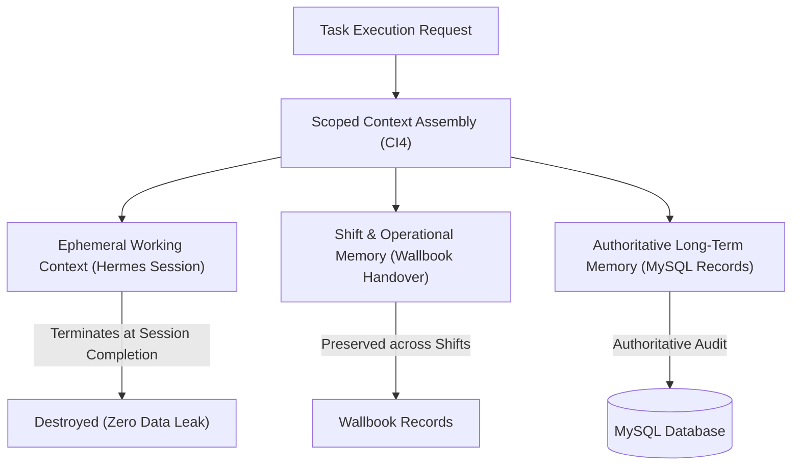

# AI Agent Memory & Context Governance Architecture

## 1. Context Boundaries & Memory Policy

In MCE AI Office, agent memory is not an uncontrolled, monolithic vector store. Memory and context are strictly governed according to organizational boundaries, corporate data classification, and lifecycle states.

### Three Tiers of Memory
1. **Tier 1: Ephemeral Working Memory (Session-Scoped)**:
   - Resides strictly in the Hermes runtime container or execution session.
   - Cleared completely upon session completion or cancellation.
   - Bounded by `context_window_limit` defined in `model_routing_profiles`.
2. **Tier 2: Operational Shift Memory (Wallbook-Scoped)**:
   - Handed over explicitly between duty shifts via `wallbook_handovers`.
   - Contains operational risks, active task states, blocker notes, and directives.
3. **Tier 3: Corporate Authoritative Memory (MySQL-Scoped)**:
   - Historical task deliverables, review evaluations, and performance records.
   - Immutable and auditable across agent lifecycles.

---

## 2. Context Assembly Governance

`ExecutionDispatchService::assembleContext` builds an isolated, role-tailored execution context:
- **Identity Scope**: Agent code, display name, classification, and DoA limits.
- **Task Scope**: Title, objective, constraints, expected deliverables, and deadline.
- **Organizational Scope**: Division name, unit code, and core values alignment.
- **Tools Scope**: Allowed sandbox tools and execution schemas.
- **Sanitization**: Context excludes raw credentials, other agents' private memory, and unrelated corporate records.
