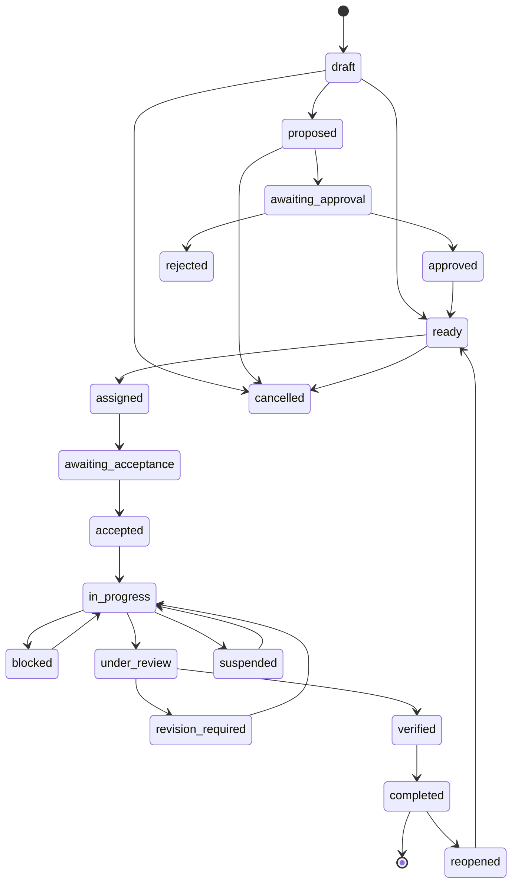

# AI Task Management Architecture — MCE AI Office

## 1. Executive Overview
The Task Management Control Plane governs all operational, strategic, development, and maintenance work within MCE AI Office. Tasks are not arbitrary strings or unstructured tickets; they are formal, authoritative organizational work packages explicitly bound to organizational units, delegated authority levels (DoA), and designated accountable AI agents.

## 2. Core Architectural Principles
1. **Never Ownerless**: Every task has an immutable or explicitly re-assigned `accountable_agent_id`. Ownerless work cannot be created in the Task Control Plane.
2. **Authority-Bounded**: Every task records an `approval_level` (`routine`, `level_c`, `level_b`, `level_a`) and origin context (`owner_advisory`, `owner_binding`, `board_decision`, `division_head`, `customer_project`, `recurring_operational`). Binding Continuous Executive Board directives are flagged with `is_binding_instruction = 1`.
3. **17-State Validated State Machine**: Task transitions must traverse an explicit state transition matrix with zero invalid jumps.
4. **Deliverable & Quality Gate**: Tasks cannot complete without accepted deliverables verified through independent peer review. Self-review is strictly forbidden.
5. **Continuous Traceability**: Every status mutation, assignment, blocker, and review logs an immutable record into `task_events_audit`.

## 3. The 17-State Task Lifecycle Matrix

### Transition Validation Rules (`TaskManagementService::ALLOWED_TRANSITIONS`)
| Current Status | Allowed Target States | Enforcement Conditions |
| :--- | :--- | :--- |
| `draft` | `proposed`, `ready`, `cancelled` | Title, objective, accountable agent, and unit defined |
| `proposed` | `awaiting_approval`, `ready`, `cancelled` | Financial threshold or binding origin check |
| `awaiting_approval`| `approved`, `draft`, `cancelled` | Executive authorization within DoA limits |
| `approved` | `ready`, `cancelled` | Ready for assignment |
| `ready` | `assigned`, `in_progress`, `cancelled`| Candidate agent eligibility verified |
| `assigned` | `awaiting_acceptance`, `in_progress`, `ready`| Candidate notified |
| `awaiting_acceptance`| `accepted`, `assigned`, `ready`| Formal acceptance by agent |
| `accepted` | `in_progress`, `ready` | Prerequisites & dependencies satisfied |
| `in_progress` | `under_review`, `blocked`, `suspended`, `completed`| Active execution work |
| `blocked` | `in_progress`, `suspended`, `cancelled`| Operational impediment active |
| `under_review` | `verified`, `revision_required`, `in_progress`| Independent reviewer assigned |
| `revision_required`| `in_progress`, `blocked` | Deliverable revision needed |
| `verified` | `completed`, `under_review` | Quality verified by reviewer |
| `completed` | `reopened` | Deliverables accepted |
| `suspended` | `in_progress`, `cancelled` | Temporary execution pause |
| `cancelled` | `draft` | Aborted work package |
| `reopened` | `ready`, `in_progress` | Scope amendment required |

## 4. Task Hierarchy & Work Packages
- **Root Tasks**: High-level initiatives or customer project milestones.
- **Subtasks (`parent_task_id`)**: Decomposed actionable units owned by specialists. Subtasks inherit the organizational unit and confidentiality level of the parent task unless explicitly bounded otherwise.
- **Cross-Division Dependencies**: Tasks may depend on prerequisite tasks across different divisions via `task_dependencies`.

## 5. Audit & Continuous Visibility
Every mutation creates an immutable audit row in `task_events_audit` capturing:
- `task_id`, `event_type`, `from_status`, `to_status`
- `actor_type` (`agent` | `human` | `system`), `actor_id`, `actor_name`
- `details` (scope transfers, unblocking evidence, review scores)
- `created_at` timestamp
