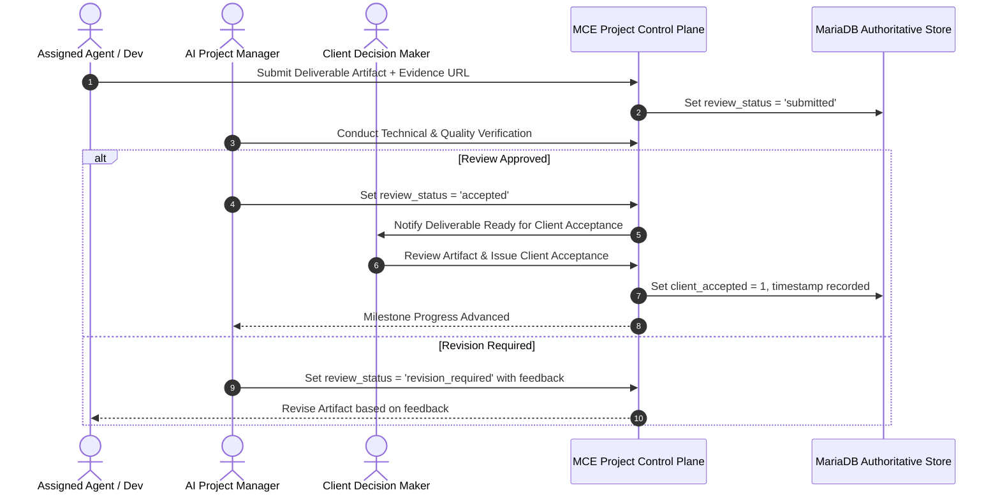

# MCE AI Office — Client Engagement Model & Boundary Specification

**Document Version:** 1.0  
**Status:** Approved & Implemented  
**Author:** Senior Enterprise Project Management System Architect  
**Classification:** Client Governance & Operational Architecture

---

## 1. Principles of Client Engagement in MCE

MCE provides high-capability AI solutions and software delivery to external commercial and governmental clients. The **Client Engagement Model** defines how external clients interact with MCE's AI workforce without exposing proprietary internal systems, sensitive executive governance, or other client data.

### 1.1 Key Principles
1. **Minimal Footprint, High Value:** MCE does NOT build or operate a massive CRM or sales marketing suite. Client management is purposefully focused on delivery excellence: client profile, key decision-maker contacts, project engagements, deliverables review, and acceptance sign-offs.
2. **Confidentiality & Non-Disclosure (NDA):** Every external client engagement is classified under `confidential` or `restricted` security tiers. Client data is logically isolated by `client_id` boundaries.
3. **Formal Deliverable Verification vs. Client Acceptance:** Deliverables must first pass internal AI and technical verification before being presented for external client acceptance.
4. **Autonomous Workforce with Human Owner Escalation:** Operational delivery is driven by AI workforce agents (Lead Architect, Senior Developer, QA Engineer) under the project leadership of assigned Project Manager agents, while executive and legal escalation paths lead directly to the Human Owner.

---

## 2. Client Profile & Stakeholder Structure

### 2.1 Enterprise Client Entity (`project_clients`)
- `client_code`: Unique identifier (e.g., `CLI-CORP-001`, `CLI-GOV-001`).
- `company_name` & `short_name`: Authoritative commercial entity name.
- `industry`: Business domain (Fintech, Public Sector, HealthTech, etc.).
- `tier`: Classification (`enterprise`, `mid_market`, `smb`, `government`, `strategic`).
- `status`: Lifecycle relation (`prospect`, `active`, `inactive`, `archived`).
- `confidentiality_level`: Default project data classification (`confidential` by default).

### 2.2 Client Contact Directory (`project_client_contacts`)
Stakeholders within the client organization are categorized by functional role:
- `sponsor`: Executive sponsor who champions the initiative and controls client-side funding.
- `decision_maker`: Authorized sign-off authority for contract execution, scope changes, and final delivery acceptance.
- `project_lead`: Day-to-day counterpart for MCE Project Managers during sprint ceremonies.
- `technical_contact`: Approver for technical architecture, API integration, and security specifications.
- `billing_contact`: Contact for milestones payment verification.

---

## 3. Deliverable Acceptance Workflow

---

## 4. Communication & Meeting Boundaries

- **Dedicated Communication Channels:** Each customer project can bind to a dedicated organizational channel (e.g., `#CHN-PRJ-DNM-001`) with confidential clearance.
- **Client Coordination Meetings:** Held in Virtual Headquarters designated rooms (`ROOM-CONF-001` or client virtual lounge), documented via Prompt 26 Meeting Management, generating bi-directional action items.
- **Data Isolation:** External client portals or API consumers are strictly filtered by `client_id` and cannot access internal initiatives or unrelated client records.
