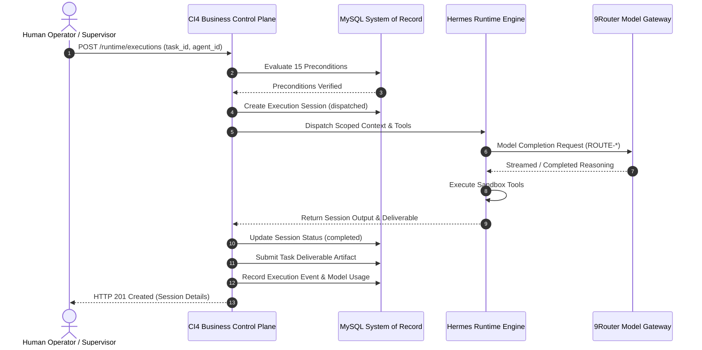

# Multi-Agent Execution Orchestration & Lifecycle Architecture

## 1. End-to-End Orchestration Workflow

The orchestration layer links CI4 task management with Hermes runtime execution and 9Router model routing:

---

## 2. Idempotency & Fault Tolerance

1. **Deterministic Deduplication**: Dispatches with matching idempotency keys return existing sessions rather than spawning concurrent duplicate processes.
2. **Cancellation Protocol**: Operators can cancel long-running or stalled sessions via `POST /runtime/executions/{id}/cancel`.
3. **Execution Attempt Tracking**: Every dispatch attempts counter (`attempt_number`) is logged in `task_execution_attempts`.
4. **Deliverable Auto-Submission**: On session completion, generated output is submitted directly as a `task_deliverables` record (`source_code` or `report`) ready for independent review.
