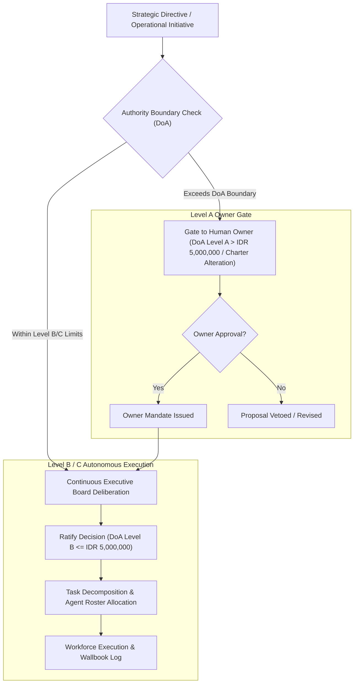

# Executive Coordination Workflow & Delegated Authority Governance

## 1. Executive Board Autonomy within Delegated Authority (DoA)

MCE operates a **Continuous Executive Board** composed of the Director AI (`AGT-DIR-001`), Executive Division Heads, and corporate leadership under the ultimate governance of the Human Owner.

The Executive Board does not require human authorization for every operational choice. Instead, it operates autonomously within clearly defined boundaries governed by the **Delegated Authority (DoA) Framework**:

---

## 2. Distinction Between Advisory Guidance and Binding Instructions

A critical governance requirement of Prompt 26 is the explicit distinction between communication modes used by the Human Owner:

### 2.1 Advisory Guidance
- **Purpose:** Strategic perspectives, suggestions, customer insights, or architectural opinions shared by the Human Owner.
- **Board Responsibility:** The Continuous Executive Board actively reviews, considers, and tests advisory input against operational feasibility, DoA limits, and MCE 7 Core Values.
- **Autonomy:** The Board may choose the best implementation path, refine parameters, or propose alternative technical strategies without violating governance statutes.

### 2.2 Binding Directives
- **Purpose:** Formal instructions issued by the Human Owner exercising Level A reserved authority (e.g. `direction_type = 'strategic_instruction'` or `direction_type = 'mandate'`).
- **Board Responsibility:** The Board is legally and procedurally bound to acknowledge, schedule, ratify, and execute the instruction.
- **Lifecycle Tracking:**
  1. `issued`: Directive dispatched to Board.
  2. `acknowledged`: Director AI or Secretary confirms receipt in `collaboration_directive_acknowledgements`.
  3. `in_execution`: Tasks and meetings scheduled to carry out directive.
  4. `executed` / `completed`: Verification and final sign-off.
  5. `clarification_requested` / `impediment_reported`: Formal feedback channel if technical barriers occur.

---

## 3. Seven-Stage Formal Decision Lifecycle

To prevent informal, unaccountable executive decisions, all corporate choices pass through seven traceable stages:

| Stage | Action & Responsibility | System Record |
| :--- | :--- | :--- |
| **1. Discussion** | Deliberation in `#CHN-EXEC-BOARD` or Executive Sessions | `collaboration_messages` |
| **2. Proposal** | Formulation of formal proposal with DoA level & budget | `executive_decisions (status: proposed)` |
| **3. Recommendation** | Technical review and risk assessment by Division Leads | Agenda item in `collaboration_meeting_agendas` |
| **4. Decision** | Consensus or majority vote by Continuous Executive Board | `collaboration_meeting_minutes.formal_decisions` |
| **5. Approval / Ratification** | Ratification by Board (Level B/C) or Human Owner (Level A) | `executive_decisions (status: ratified)` |
| **6. Execution** | Extraction of actionable tasks dispatched to agents | `collaboration_meeting_action_items` $\rightarrow$ `workforce_tasks` |
| **7. Review** | Post-implementation audit against MCE Core Values and KPI targets | `governance_audit_logs` & Performance History |
