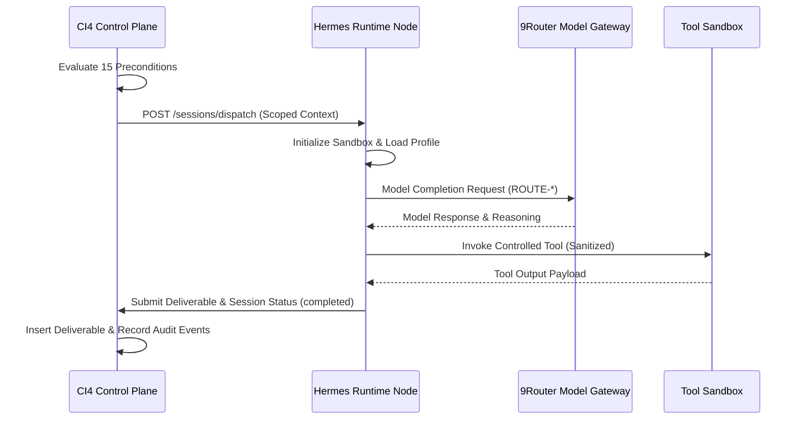

# Hermes AI Agent Runtime Integration Architecture

## 1. Architectural Purpose and Core Responsibilities

In MCE AI Office, **Hermes** serves as the distributed agent execution runtime and execution sandbox. It is responsible for hosting, running, sandboxing, and executing AI Agents according to strict organizational specifications issued by the CodeIgniter 4 (CI4) business control plane.

```mermaid
flowchart TD
    UI["React Frontend (Dashboard & Virtual HQ)"] -->|HTTP / REST (Bearer JWT)| CI4["CI4 Business Control Plane & System of Record"]
    CI4 -->|Execution Authorization (15 Preconditions)| CI4
    CI4 -->|Scoped Context & Idempotency Key| HERMES["Hermes Agent Runtime Engine"]
    HERMES -->|In-Process Sandbox Execution| TOOLS["Controlled Tool Registry"]
    HERMES -->|Sole Model Completion Egress| NINEROUTER["9Router Sole Model Gateway"]
    NINEROUTER -->|Direct Provider Bypass BLOCKED| LLMS["Upstream Models (Qwen, Llama, DeepSeek)"]
    HERMES -->|Session Output, Tokens & Events| CI4
    CI4 -->|Persist Audit, Sessions & Deliverables| MYSQL[(MySQL Business DB)]
```

### Strict Separation of Concerns
1. **CI4 is the Authoritative Control Plane**: All workforce identities, lifecycle states, organizational positions, rosters, task definitions, and Delegation of Authority (DoA) boundaries reside authoritatively in CI4. Hermes has **zero authority** to modify or override business entities.
2. **Hermes is Statelessly Provisioned**: Hermes instances receive scoped execution contexts assembled by CI4. Hermes does not retain permanent unconstrained authority.
3. **Execution Sandbox**: All tool invocations and system interactions occur inside isolated Hermes execution sandboxes with bounded filesystem and network permissions.

---

## 2. Communication Protocol & Idempotency

- **Protocol**: HTTP/REST over private local loopback (`http://127.0.0.1:8686/v1`).
- **Authentication**: Mutual pre-shared runtime node secret exchanged via CI4 runtime environment configurations (`runtime_environments`).
- **Idempotency Protection**: Every execution dispatch payload includes a cryptographically secure `idempotency_key` (`SHA-256(task_id:agent_id:nonce)`). Duplicate requests returning the same idempotency key are deduplicated immediately by CI4 without triggering redundant runtime instances.
- **Controlled Simulation Fallback**: When live Hermes daemons are absent during local development or unit testing, the system transparently utilizes `HermesRuntimeAdapter`'s simulation mode, accurately reporting latency, tokens, and outputs while preserving complete audit fidelity.

---

## 3. Agent Execution Lifecycle within Hermes



---

## 4. Architectural Boundaries

- **No Autonomous Agent Registration**: Hermes cannot register or recruit new agents; all agents originate in `ai_agent_registry`.
- **No Direct LLM Provider Calls**: Hermes instances must route all LLM requests through 9Router. Direct egress to OpenAI, Anthropic, or external providers is blocked at the network policy layer.
- **Audit Immutability**: All chronological execution events (`session_initialized`, `session_dispatched`, `runtime_connected`, `tool_invoked`, `output_generated`) are captured in `runtime_execution_events`.
