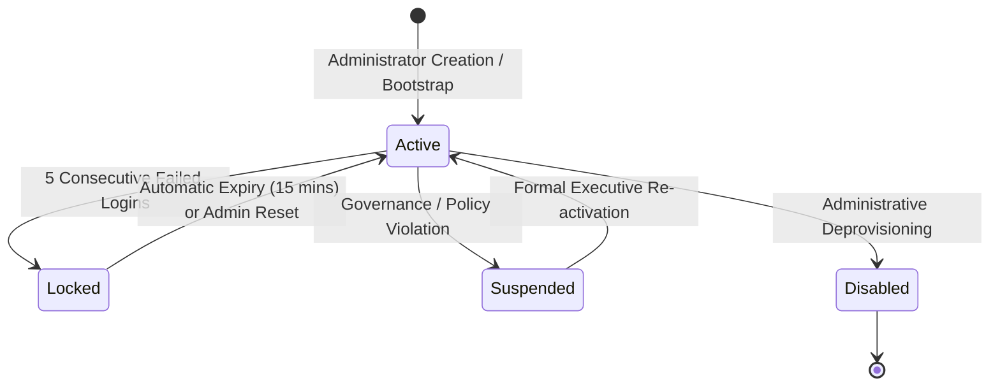

# IDENTITY ARCHITECTURE & BOUNDARIES
## MCE AI Office — Human, Agent & Runtime Identity Model
**Document Code:** `MCE-ARC-IDENT-2026-V1`  
**Status:** Approved & Implemented (Prompt 17)

---

## 1. The Three Identity Domains

A foundational principle of MCE AI Office is the strict separation between three distinct identity domains:

```text
┌─────────────────────────────────────────────────────────────────────────┐
│                      MCE AI OFFICE IDENTITY MATRIX                      │
├─────────────────────┬─────────────────────────┬─────────────────────────┤
│    1. HUMAN USER    │       2. AI AGENT       │   3. RUNTIME IDENTITY   │
├─────────────────────┼─────────────────────────┼─────────────────────────┤
│ • Interactive human │ • Autonomous digital    │ • Technical execution   │
│   operators/owners  │   workforce member      │   context (Docker/API)  │
│ • Authenticates via │ • Identified by stable  │ • Ephemeral sandbox     │
│   login credentials │   organizational key    │   security context      │
│ • Bearer token/     │ • Shift, Wallbook, and  │ • Bound to an authorized│
│   session lifecycle │   Welfare lifecycle     │   Agent for 1 turn      │
│ • Table: `users`    │ • Table: `agents`       │ • No independent org    │
│                     │                         │   authority or roles    │
└─────────────────────┴─────────────────────────┴─────────────────────────┘
```

### 1.1 Human User Identity
Human users represent the physical persons who govern, direct, monitor, and configure MCE AI Office.
- **Identity Storage**: `users` table.
- **Credential Storage**: Passwords hashed using **Argon2id** (memory cost 65536 KiB, time cost 4, threads 1).
- **Session Transport**: Cryptographically random 256-bit opaque tokens hashed with **SHA-256** at rest.
- **Authorization**: User-Role mapping (`user_roles`) resolving to granular permissions (`permissions`).

### 1.2 AI Agent Identity (Boundary Definition)
AI Agents represent the autonomous cognitive workforce of MCE (e.g. `director`, `tech_head`, `dev_ai`, `qa_ai`).
- **Separation Guarantee**: Agent identities are NEVER mixed into the human `users` table.
- **Entity Storage**: Reside in the dedicated `agents` table.
- **Authority Delegation**: Agents operate under designated governance approval levels (Level A, B, C) and do NOT hold human interactive login sessions.

### 1.3 Technical Runtime Identity (Hermes Sandbox Boundary)
The runtime identity is the technical credentials used by the execution harness (e.g. Hermes Agent Runtime inside ephemeral Docker containers).
- **Scope**: Ephemeral and strictly bounded to a single assigned task or subtask turn.
- **Permissions**: Technical runtime identities do not hold global application permissions; they inherit the capability scope explicitly dispatched by the CI4 backend for that subtask.
- **Isolation**: Hermes never directly connects to the MySQL database or executes privileged administrative actions.

---

## 2. Human Account Lifecycle State Machine



- **Active**: Full access according to assigned roles and permissions.
- **Locked**: Temporarily throttled after 5 failed authentication attempts for 15 minutes.
- **Suspended**: Manually placed on hold under compliance or risk investigation.
- **Disabled**: Permanently deactivated; all issued tokens revoked immediately.
