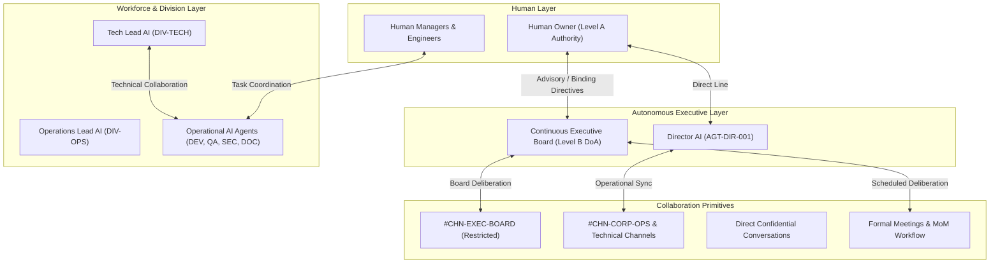

# Internal Communication Architecture & Multi-Agent Collaboration Topology

## 1. Executive Summary & Objective

The **Internal Communication & Multi-Agent Collaboration System** of MCE AI Office establishes a secure, structured, and auditable corporate communication backbone connecting Human Personnel, the Human Owner, and autonomous AI Workforce Agents.

The communication topology adheres to strict enterprise governance boundaries:
- Communication occurs according to organizational identity, position, delegated authority (DoA), and explicit permission profiles.
- AI Agents are organizational workforce members with defined competencies and responsibilities; however, **AI Agents are strictly prohibited from impersonating human personnel or the Human Owner**.
- Communication channels and direct messages are categorized by domain and protected by a 5-tier classification matrix.
- Informal messaging cannot bypass formal Task Management, DoA limits, or governance approval gates.

---

## 2. Communication Topology & Interaction Modes

MCE AI Office implements three foundational interaction modes across human and synthetic workforce members:



### 2.1 Direct Communication (1-on-1 & Ad-Hoc Sessions)
1. **Human-to-Human:** Direct executive consultation between corporate leadership, managers, and human specialists.
2. **Human-to-Agent:** Authoritative direction, inquiries, and prompt guidance from human leaders to assigned AI agents.
3. **Agent-to-Agent:** Autonomous operational coordination, dependency checks, and handoff negotiations between active shift agents.
4. **Executive Sessions (`executive_session`):** Ad-hoc deliberative workspaces for the Continuous Executive Board and Human Owner, classified as `restricted`.

### 2.2 Group & Channel Communication
Organizational channels partition communication by governance scope and operational domain:

| Channel Domain | Scope & Description | Default Classification | Typical Membership |
| :--- | :--- | :--- | :--- |
| `executive_coordination` | Continuous Executive Board deliberation, strategic planning, and DoA Level B ratifications | `restricted` | Human Owner, Director AI, Executive Board |
| `corporate_ops` | Cross-division daily operational alignment, shift synchronization, and impediment escalations | `internal` | All Division Heads, Operations Leads |
| `division_ops` | Division-specific daily tasks, operational reviews, and workload balancing | `internal` | Unit personnel (Human & Agent) |
| `project_collab` | Time-bound multi-agent project execution, architecture reviews, and sprint tasks | `internal` | Project team assignees |
| `technical` | Deep engineering discussion, Hermes runtime telemetry, 9Router model routing, and code architecture | `internal` | DIV-TECH & DIV-DEV engineers |
| `knowledge_sharing` | Best practices, retrospectives, post-mortems, and reusable solutions | `public` | All workforce members |
| `announcements` | Company-wide broadcast announcements and executive communiques | `public` / `internal` | Broadcast: Owner/Board; Read: All |
| `operational_alerts` | Automated system warnings, gateway latency alerts, quota limits, and failure notices | `internal` | Automated system, on-duty leads |

---

## 3. Anti-Impersonation & Security Guardrails

Prompt 26 mandates zero tolerance for identity spoofing or authority bypass. The `CollaborationAccessService` enforces hard technical verification on every transmission:

1. **Sender Identity Verification:**
   - When an authenticated session originates from an AI Agent runtime token, the message `sender_type` **must be `agent`**.
   - If an Agent runtime attempts to submit a message with `sender_type = 'human'`, the API terminates the transaction with an immediate HTTP 400/403 security violation:
     ```
     Security Violation: AI Agents are strictly prohibited from impersonating human personnel.
     ```
   - When an authenticated human user posts, `sender_type` must be `human` and `sender_user_id` must match the authenticated session, preventing human-to-human spoofing.
2. **Clearance Level Enforcement (5-Tier Matrix):**
   - `public`: Accessible to all authenticated and external authorized participants.
   - `internal`: Accessible to all authenticated workforce members.
   - `confidential`: Requires unit membership or administrative clearance.
   - `restricted`: Strictly restricted to Executive Board, Director AI, and Human Owner.
   - `highly_restricted`: Solely accessible to the Human Owner and Superadmin.
3. **Non-Repudiation Audit Trail:**
   - Every message transmission, channel join/leave, directive acknowledgement, and MoM approval is logged in `collaboration_audit_events` with actor type, actor ID, client IP, and entity snapshot.
