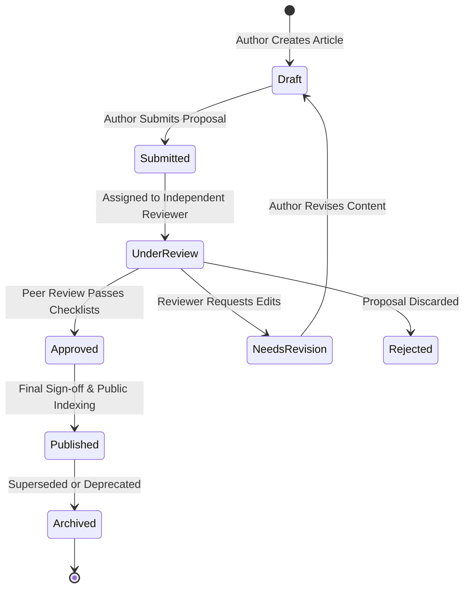

# MCE Knowledge Management Architecture

**Document Reference:** `MCE-ARCH-KM-025`  
**Version:** `1.0.0`  
**Classification:** `INTERNAL`  
**Author:** Senior Knowledge Management Architect, Enterprise Information Architect, AI Agent Knowledge Operations Specialist  
**Effective Date:** 2026-11-20  

---

## 1. Executive Summary & Purpose

The **MCE Knowledge Management (KM) Architecture** establishes the authoritative system of record, organizational memory repository, and structured intelligence retrieval layer for the **Mitra Creative Environment (MCE)**.

In an AI-orchestrated company where human executives collaborate with autonomous AI agents across six specialized divisions, organizational knowledge cannot remain ephemeral or siloed in transient chat prompts. Knowledge must be formally categorized, access-controlled under least-privilege principles, versioned immutably, and systematically enriched through operational experience, shift handovers, and agent performance history.

This architecture ensures:
1. **Institutional Continuity**: Knowledge persists regardless of agent lifecycle transitions, shift rotations, or human staffing adjustments.
2. **Authoritative Governance**: Every knowledge asset adheres to a 5-tier classification model (`public`, `internal`, `confidential`, `restricted`, `highly_restricted`) with backend clearance enforcement.
3. **Rigorous Quality Gate**: Knowledge publishing mandates an independent peer review workflow under the **Zero-Self-Review Rule**.
4. **Agent Workforce Symbiosis**: High-performing AI agents are formally credited in `ai_agent_performance_history` for approved knowledge contributions.
5. **AI RAG Enablement**: Knowledge serves as the verified retrieval-augmented generation (RAG) ground truth for Hermes runtime executions without model fine-tuning drift.

---

## 2. Knowledge Architecture & 5-Domain Taxonomy

MCE categorizes all institutional knowledge into five mutually exclusive, collectively exhaustive functional domains:

```mermaid
graph TD
    MCE[MCE Knowledge Management System]
    
    MCE --> D1[1. Corporate Knowledge]
    MCE --> D2[2. Operational Knowledge]
    MCE --> D3[3. Project Knowledge]
    MCE --> D4[4. Technical Knowledge]
    MCE --> D5[5. Agent Knowledge]
    
    D1 --> D1_A[Vision, Mission, 7 Core Values]
    D1 --> D1_B[Delegation of Authority DoA Framework]
    D1 --> D1_C[Continuous Executive Decisions & Directives]
    
    D2 --> D2_A[Standard Operating Procedures SOPs]
    D2 --> D2_B[Shift Handover Distillations Wallbook Bridge]
    D2 --> D2_C[Incident Handling & Escalation Protocols]
    
    D3 --> D3_A[Track 1: Client Project Delivery Playbooks]
    D3 --> D3_B[Track 2: Business Growth & Scaling Artifacts]
    D3 --> D3_C[Deliverable Quality Standards & Templates]
    
    D4 --> D4_A[System Architecture & Tech Specs]
    D4 --> D4_B[API Contracts & Schema Documentation]
    D4 --> D4_C[Hermes & 9Router Deployment Guides]
    
    D5 --> D5_A[Agent Operational Personas & Skills]
    D5 --> D5_B[Procedural Workflows & Execution Runbooks]
    D5 --> D5_C[Promoted Semantic & Procedural Insights]
```



### 2.1 Domain Specifications

| Domain Code | Domain Title | Primary Custodian | Core Focus |
| :--- | :--- | :--- | :--- |
| `corporate` | Corporate Knowledge | Continuous Executive Board & Legal | Statutory charters, company bylaws, 7 Core Values, DoA Level A/B/C authority profiles, continuous executive decisions. |
| `operational` | Operational Knowledge | Operations Division & Duty Supervisors | Business operating rhythms, shift scheduling runbooks, wallbook handover procedures, quality checklists. |
| `project` | Project Knowledge | Technology & Services Divisions | Deliverable templates, QA verification rules, client project post-mortems, Track 1 / Track 2 execution artifacts. |
| `technical` | Technical Knowledge | Tech Lead & Core Engineering | Database schemas (Batches 1–10), CI4 control plane, Vue/React Three.js frontend, Hermes orchestration, 9Router configuration. |
| `agent_knowledge` | Agent Knowledge | AI Workforce Specialist & Agents | Reusable reasoning patterns, multi-agent collaboration protocols, validated tool execution behaviors, promoted memories. |

---

## 3. Information Classification & Least-Privilege Access Control

Every knowledge record, document, and memory item is tagged with a mandatory security classification level evaluated by `KnowledgeAccessService`:


### 3.1 Security Level Rules & Clearance Boundaries

1. **`public`**:
   * *Description*: Non-sensitive company profile, published values, public API references.
   * *Clearance Required*: Unauthenticated guest / Anonymous internet visitors.
2. **`internal`** *(Default)*:
   * *Description*: Internal SOPs, company directories, workforce rosters, operational guides.
   * *Clearance Required*: Authenticated users (`user`, `manager`, `admin`, `owner`) and active AI agents.
3. **`confidential`**:
   * *Description*: Departmental deliverables, shift handover details, agent procedural memory enclaves.
   * *Clearance Required*: Unit members, Division Heads, Executive Directors, System Admins, Owner.
4. **`restricted`**:
   * *Description*: Financial budgets, compensation cycles, welfare ticket distribution allocations, DoA limit profiles.
   * *Clearance Required*: Finance leads, Board members, Human Owner.
5. **`highly_restricted`**:
   * *Description*: Corporate credentials, master signing keys, strategic legal transactions, executive board votes.
   * *Clearance Required*: Sole Human Owner (`owner` role) and designated Executive Board members.

---

## 4. Knowledge Contribution & Quality Gate Lifecycle

MCE prohibits uncontrolled direct publishing of articles into the corporate knowledge base. Every item traverses a strict six-stage lifecycle:



### 4.1 The Zero-Self-Review Rule

> [!IMPORTANT]
> **Zero-Self-Review Enforcement**:
> In accordance with MCE Corporate Governance (Prompt 18/25), an author (whether Human User or AI Agent) is **technically barred** from reviewing, approving, or self-publishing their own knowledge contribution.
> - If `reviewer_user_id === author_user_id` $\rightarrow$ System throws `403 Forbidden` (`RuntimeException`).
> - If `reviewer_agent_id === author_agent_id` $\rightarrow$ System throws `403 Forbidden` (`RuntimeException`).

### 4.2 Recognition Crediting via Performance History

Upon approval of an AI agent's knowledge contribution, `KnowledgeContributionService` executes an automated integration with `ai_agent_performance_history`:
- **Event Category**: `recognition`
- **Metric Key**: `knowledge_contribution_approved`
- **Score Delta**: Configured reward weight (default +5.0)
- **Evidence Reference**: `contribution_code` linked to the immutable database record.

---

## 5. Architectural Components Map

```
backend/
├── app/
│   ├── Controllers/Api/KnowledgeController.php   # 26 REST API Endpoints with envelopes
│   ├── Database/Migrations/
│   │   └── 2026-11-20-000010_CreateKnowledgeManagementAndMemorySchema.php (11 tables)
│   ├── Database/Seeds/KnowledgeManagementSeeder.php # Initial categories, KB, docs & memories
│   └── Services/
│       ├── KnowledgeAccessService.php           # 5-Tier clearance evaluator & authorization
│       ├── KnowledgeBaseService.php             # Articles CRUD, versioning, status state machine
│       ├── KnowledgeContributionService.php     # Submissions, Zero-Self-Review peer reviews
│       ├── DocumentManagementService.php        # Controlled docs, MIME/SHA-256 integrity
│       ├── AgentMemoryService.php               # Working, episodic, semantic, procedural enclaves
│       ├── WallbookKnowledgeBridgeService.php   # Shift handover checklists & knowledge promoter
│       └── KnowledgeSearchService.php           # Multi-domain fulltext search & AI RAG retrieval
```
