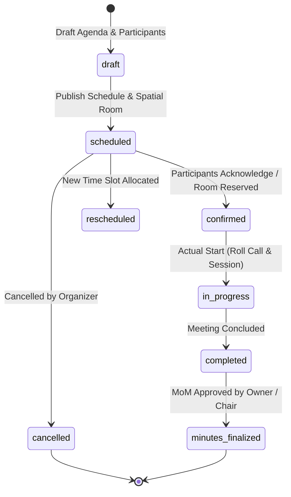
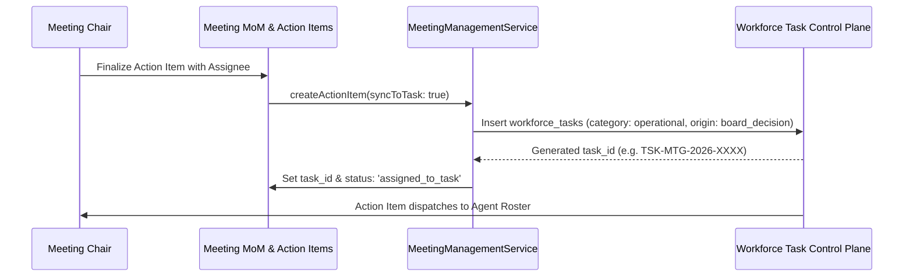

# Meeting Management, Minutes of Meeting (MoM) & Action Item Architecture

## 1. Meeting Management Lifecycle

Meetings within MCE AI Office are formal operational and governance events. They follow a controlled 8-state lifecycle state machine:

### 1.1 State Definitions
- `draft`: Internal preparation of agenda topics and invite list.
- `scheduled`: Meeting committed to calendar with spatial room binding to `hq_rooms`.
- `confirmed`: Quorum confirmed by participant acknowledgements.
- `in_progress`: Active session; `actual_start_time` recorded; live deliberation underway.
- `completed`: Session closed; `actual_end_time` recorded; ready for minutes preparation.
- `minutes_finalized`: Formal Minutes of Meeting approved by Human Owner or Chair; action items exported to tasks.
- `cancelled` / `rescheduled`: Exceptional lifecycle termination or time shift.

---

## 2. Spatial Room Binding to Virtual Headquarters (VHQ)

Every meeting can be explicitly bound to an active 3D spatial room in the Virtual Headquarters via foreign key `collaboration_meetings.room_id` $\rightarrow$ `hq_rooms.id`:

| VHQ Room Code | Functional Zone | Building | Primary Meeting Category |
| :--- | :--- | :--- | :--- |
| `ROOM-MAIN-BOARD` | Continuous Executive Boardroom | Main Executive Tower (Floor 2) | `board_meeting`, `executive_coordination` |
| `ROOM-DIR-SUITE` | Director AI Executive Suite | Main Executive Tower (Floor 2) | Direct executive alignment, policy review |
| `ROOM-MAIN-MONITOR`| Central Operations Monitoring | Main Executive Tower (Floor 1) | Operational incident reviews, shift syncs |
| `ROOM-TECH-DEV` | Software Engineering Lab | Technology Pavilion | `technical_review`, Hermes runtime reviews |
| `ROOM-SRV-STUDIO` | Creative & Enterprise Solutions | Services Pavilion | `project_meeting`, client delivery reviews |
| `ROOM-WLF-LOUNGE` | Welfare Commons Lounge | Welfare Pavilion | Workforce wellness reviews, rest alignment |

---

## 3. Minutes of Meeting (MoM) Approval Gate

The Minutes of Meeting (`collaboration_meeting_minutes`) provide permanent organizational accountability:
1. **Preparation:** Prepared by the meeting secretary (e.g. Director AI `prepared_by_agent_id` or designated human secretary `prepared_by_user_id`).
2. **Contents:**
   - **Attendance Summary:** Confirms attendees, absentees, and quorum compliance.
   - **Discussion Notes:** Key points, technical trade-offs, and perspectives expressed.
   - **Formal Decisions:** Numbered, binding resolutions agreed upon.
3. **Approval Gate:** MoM is strictly immutable once ratified by the Human Owner or authorized Executive Chair (`is_approved = 1`, `approved_by_user_id`, `approved_at`).

---

## 4. Bi-Directional Action Item to Task Synchronization

To prevent meetings from becoming passive discussion forums, every action item created in `collaboration_meeting_action_items` features bi-directional integration with the MCE Task Management system (`workforce_tasks`):

- When `sync_to_task` is enabled, an authoritative task record is created in `workforce_tasks` with category `operational` and origin `board_decision`.
- If assigned to an agent, a primary assignment is created in `task_assignments`.
- When the task is completed by the workforce, the action item status updates automatically to `completed`.
