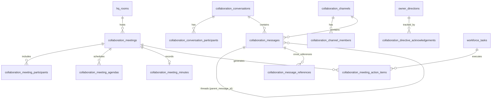

# Messaging & Collaboration Data Model

## 1. Overview & ERD Relationships

The Internal Communication, Executive Coordination, and Meeting Management data schema (Migration Batch 11) introduces 15 relational tables designed to support high-throughput, structured, and auditable interactions between human personnel and AI workforce agents.

---

## 2. Relational Table Specifications

### 2.1 Conversations & Channels
1. `collaboration_conversations`: Direct 1-on-1, group discussions, and confidential executive sessions (`type` ENUM: `direct`, `group`, `executive_session`). Classification: `public`, `internal`, `confidential`, `restricted`, `highly_restricted`.
2. `collaboration_conversation_participants`: Human and AI Agent participants with roles (`owner`, `admin`, `member`), muting preferences, and read tracking (`last_read_message_id`).
3. `collaboration_channels`: Scoped organizational channels categorized by domain (`executive_coordination`, `corporate_ops`, `division_ops`, `project_collab`, `technical`, `knowledge_sharing`, `announcements`, `operational_alerts`), privacy flags, and optional organizational unit scoping (`scope_unit_id`).
4. `collaboration_channel_members`: Explicit membership registry for private channels and notification subscription preferences (`role`: `admin`, `moderator`, `member`).

### 2.2 Messages & Polymorphic Cross-References
5. `collaboration_messages`:
   - Unique message code (`MSG-YYYY-XXXXXX`).
   - Targets either `channel_id` OR `conversation_id`.
   - Supports message threading via `parent_message_id`.
   - Strict identity columns: `sender_type` (`human`, `agent`, `system`), `sender_user_id`, `sender_agent_id`, and `sender_display_name`.
   - Content formats: `text`, `markdown`, `system_event`.
   - Pinning (`is_pinned`), soft-editing (`is_edited`), and soft-deletion (`is_deleted`).
6. `collaboration_message_references`:
   - Polymorphic linking table binding messages to organizational artifacts:
     - `task` $\rightarrow$ `workforce_tasks.id`
     - `document` $\rightarrow$ `corporate_documents.id`
     - `knowledge_record` $\rightarrow$ `knowledge_records.id`
     - `wallbook_handover` $\rightarrow$ `wallbook_handovers.id`
     - `owner_direction` $\rightarrow$ `owner_directions.id`
     - `executive_decision` $\rightarrow$ `executive_decisions.id`
     - `meeting` $\rightarrow$ `collaboration_meetings.id`

### 2.3 Official Announcements
7. `collaboration_announcements`:
   - Structured corporate broadcast notices with audience scopes (`all_organization`, `division`, `unit`, `project_team`).
   - Priority ratings: `routine`, `important`, `urgent`, `critical`.
   - Publisher attribution and expiration timestamps.

### 2.4 Meeting Management & MoM
8. `collaboration_meetings`:
   - Structured meeting entity bound to Virtual Headquarters rooms via `room_id` $\rightarrow$ `hq_rooms.id`.
   - Categories: `board_meeting`, `executive_coordination`, `division_sync`, `cross_division`, `project_meeting`, `technical_review`, `operational_planning`.
   - Formal status machine: `draft` $\rightarrow$ `scheduled` $\rightarrow$ `confirmed` $\rightarrow$ `in_progress` $\rightarrow$ `completed` $\rightarrow$ `minutes_finalized`.
9. `collaboration_meeting_participants`: Attendance roll-call (`attended`, `absent`, `excused`) and meeting roles (`chair`, `secretary`, `participant`, `observer`).
10. `collaboration_meeting_agendas`: Time-allocated agenda items with order and status (`pending`, `in_discussion`, `concluded`, `tabled`).
11. `collaboration_meeting_minutes`: Formal Minutes of Meeting (MoM) capturing attendance summary, discussion notes, and formal decisions with executive sign-off (`is_approved`, `approved_by_user_id`, `approved_at`).
12. `collaboration_meeting_action_items`: Actionable tasks extracted from meetings with bi-directional foreign key binding to `workforce_tasks.id`.

### 2.5 Governance Tracking & Notifications
13. `collaboration_directive_acknowledgements`: Explicit dialogue and execution progress tracking on `owner_directions` (`acknowledged`, `clarification_requested`, `in_execution`, `executed`, `impediment_reported`).
14. `collaboration_notifications`: Real-time notification center delivering alerts, mentions, meeting invites, directive notifications, and action item assignments across human and synthetic personnel.
15. `collaboration_audit_events`: Tamper-evident communication audit trail recording actor, action, timestamp, and IP address.
