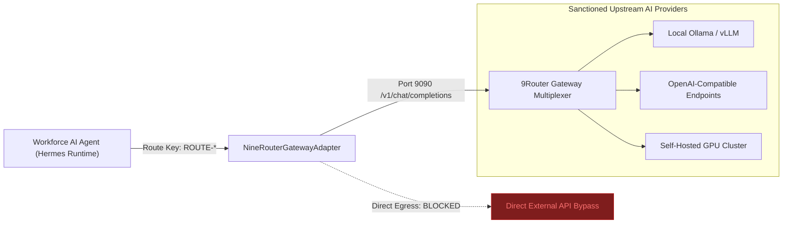

# 9Router AI Model Gateway Integration Architecture

## 1. Role as the Sole Model Gateway

In the MCE AI Office enterprise architecture, **9Router** is established as the **sole, exclusive AI Model Gateway**. All model completion requests, embeddings, and inference streams from Hermes or workforce systems must traverse 9Router.

### Invariant Rules
1. **Zero Provider Bypass**: Direct provider API calls bypassing 9Router are categorically forbidden.
2. **Zero Provider Secrets in Frontend/Git**: Raw provider keys (e.g. OpenAI, Anthropic, Mistral) are never checked into Git, stored in frontend bundles, or exposed in CI4 HTTP responses.
3. **Sole Gateway Policy**: Enforced by `NineRouterGatewayAdapter::requestCompletion()` and verified in runtime health diagnostics (`sole_gateway_enforced: true`, `direct_bypass_policy: BLOCKED`).

---

## 2. Model Routing Profiles

MCE configures specialized routing profiles targeting specific organizational workloads:

| Profile Code | Profile Name | Primary Model | Fallback Model | Context Window | Target Division |
| :--- | :--- | :--- | :--- | :--- | :--- |
| `ROUTE-FAST-REASONING` | Fast Operational Reasoning | `qwen2.5:14b-instruct` | `llama3.2:3b` | 32,768 | All Divisions (Routine) |
| `ROUTE-DEEP-RESEARCH` | Deep Research & Synthesis | `deepseek-r1:32b` | `qwen2.5:32b-instruct` | 65,536 | Research & Governance |
| `ROUTE-CODE-GEN` | Full-Stack Software Generation | `qwen2.5-coder:32b` | `deepseek-coder:33b` | 65,536 | DIV-TECH & DIV-DEV |
| `ROUTE-HARDWARE-AUDIT`| Hardware Telemetry Analysis | `qwen2.5:14b-hardware` | `llama3.2:3b` | 32,768 | DIV-HW (Hardware AI) |
| `ROUTE-GOVERNANCE` | Corporate Governance & Legal | `deepseek-r1:70b` | `qwen2.5:32b-instruct` | 131,072 | Executive Board & Owner |

---

## 3. Fallback and Failover Mechanism

If the primary model target encounters timeout, rate limit, or socket exhaustion, 9Router automatically evaluates the configured `fallback_model`:
1. `failover_count` is incremented.
2. Latency and status code are logged.
3. Fallback request is completed transparently to the requesting agent.
4. CI4 receives metadata identifying whether the primary or fallback route serviced the completion.

---

## 4. Authoritative Usage and Cost Accounting

Every model request processed through 9Router is recorded in MySQL `model_requests_usage`:
- `prompt_tokens`: Actual input tokens consumed.
- `completion_tokens`: Output reasoning and content tokens.
- `total_tokens`: Aggregate token count.
- `estimated_cost_idr`: Cost calculated using exact profile rates (`cost_per_1k_input`, `cost_per_1k_output`).
- `latency_ms`: Response duration.
- `correlation_id`: Distributed trace identifier (`corr_*`).
