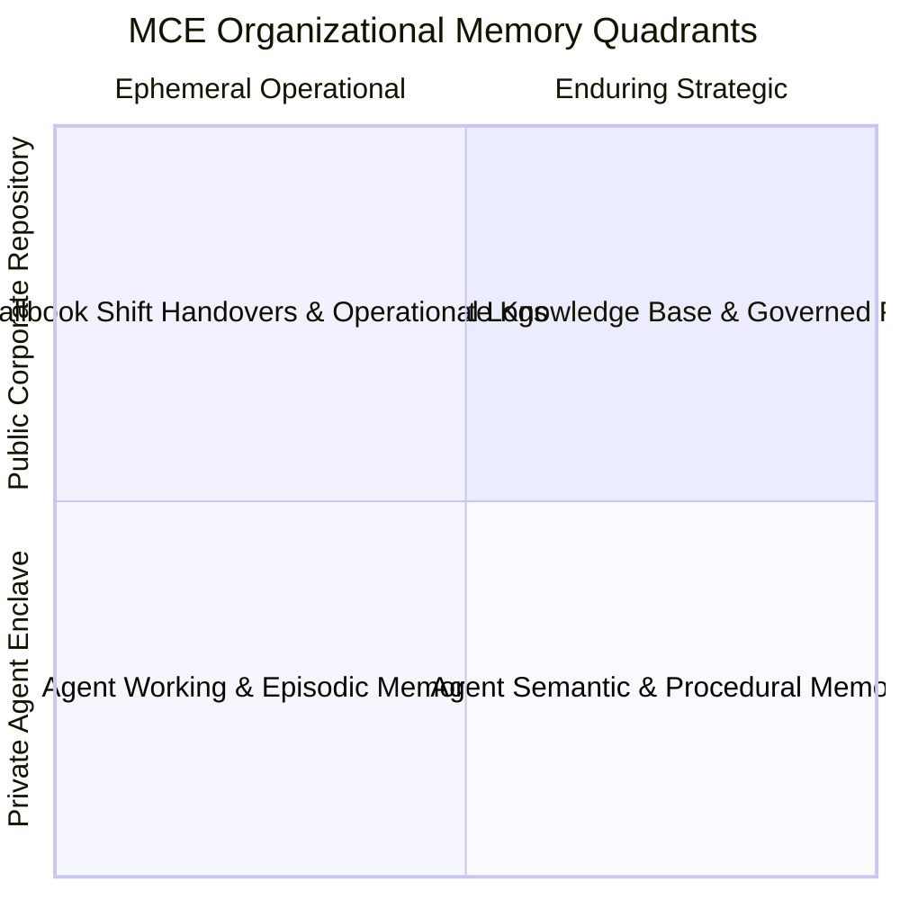
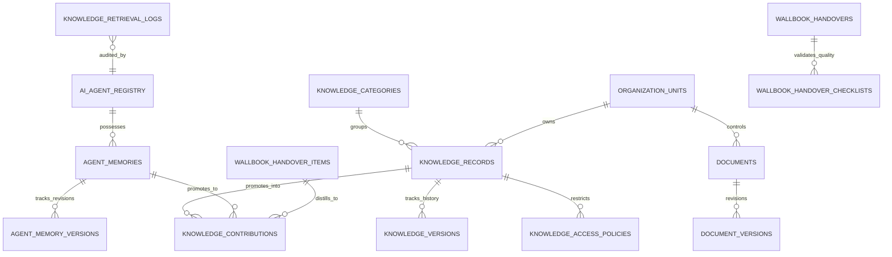
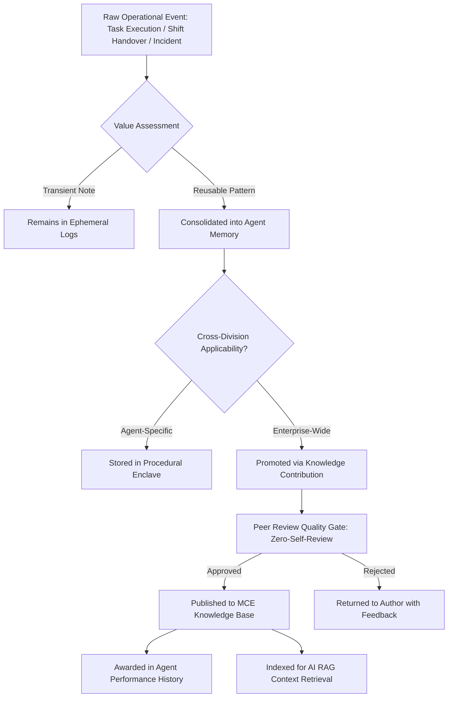

# MCE Organizational Memory Model

**Document Reference:** `MCE-ARCH-OMM-025`  
**Version:** `1.0.0`  
**Classification:** `INTERNAL`  
**Author:** Enterprise Information Architect, Senior Knowledge Management Architect  
**Effective Date:** 2026-11-20  

---

## 1. Concept of Organizational Memory in MCE

**Organizational Memory (OM)** is the accumulated body of data, operational context, strategic decisions, historical outcomes, and procedural know-how that enables MCE to function as a coherent, self-improving enterprise.

Traditional organizations suffer from **organizational amnesia** when key personnel leave or shift teams. In an AI-augmented company, organizational amnesia represents an unacceptable risk: if an AI agent is replaced, redeployed, or upgraded, its operational learnings must not vanish.

MCE solves this through a dual-plane memory architecture:
1. **The Shared Corporate Memory Plane**: Collective, immutable, categorized, and peer-reviewed organizational knowledge (Knowledge Base, Controlled Documents, Wallbook Archives, Governance Decisions).
2. **The Agent Individual Memory Plane**: Specialized working, episodic, semantic, and procedural memories partitioned inside private agent enclaves, with structured promotion pathways into the corporate plane.

---

## 2. The Four Pillars of Organizational Memory

### Pillar 1: Strategic & Governance Memory (`corporate`)
- **Persistence**: Permanent / Immutable.
- **Artifacts**: Founder Directions, Continuous Executive Decisions, DoA Authority Profiles, 7 Core Values, Corporate Charter.
- **Storage**: `continuous_executive_decisions`, `owner_directions`, `governance_bodies`, `knowledge_records`.
- **Purpose**: Authoritative strategic alignment; prevents conflicting policies.

### Pillar 2: Operational & Shift Memory (`operational`)
- **Persistence**: Rolling 1-year active, archived permanently.
- **Artifacts**: Daily Shift Handover Logs, Quality Checklists, Incident Resolutions, Welfare Session Logs.
- **Storage**: `wallbook_handovers`, `wallbook_handover_items`, `wallbook_handover_checklists`, `welfare_facility_sessions`.
- **Purpose**: Seamless duty transition across staggered 5/2 schedules without operational drop-offs.

### Pillar 3: Project Delivery & Engineering Memory (`project` / `technical`)
- **Persistence**: Project duration + 3 years archival.
- **Artifacts**: Architecture blueprints, API contracts, deliverable reviews, task dependencies.
- **Storage**: `tasks`, `task_deliverables`, `task_reviews`, `knowledge_records`, `documents`.
- **Purpose**: Ensures quality benchmarks are systematically applied to all client work.

### Pillar 4: Agent Evolutionary Memory (`agent_knowledge`)
- **Persistence**: Lifecycle duration of agent profile + cross-agent distillation.
- **Artifacts**: Resolved exception patterns, optimal tool parameter combinations, prompt performance benchmarks.
- **Storage**: `agent_memories`, `agent_memory_versions`, `knowledge_contributions`.
- **Purpose**: Prevents repeated trial-and-error cycles across runtime execution sessions.

---

## 3. Organizational Memory Data Schema & Relational Map

The schema established in Migration Batch 10 (`CreateKnowledgeManagementAndMemorySchema`) links organizational memory directly to core business entities:

---

## 4. Organizational Memory Promotion Flow

Knowledge is not passively static; it flows dynamically upwards from raw operational activity into governed corporate memory:

This memory promotion engine guarantees that operational breakthroughs achieved by a single agent or department immediately become enterprise-wide organizational capabilities.
