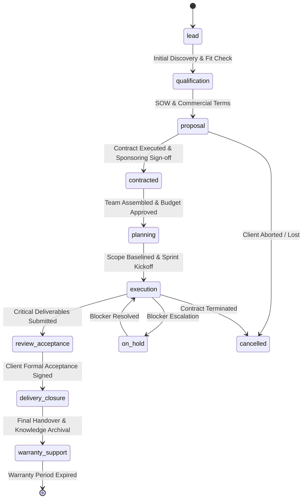
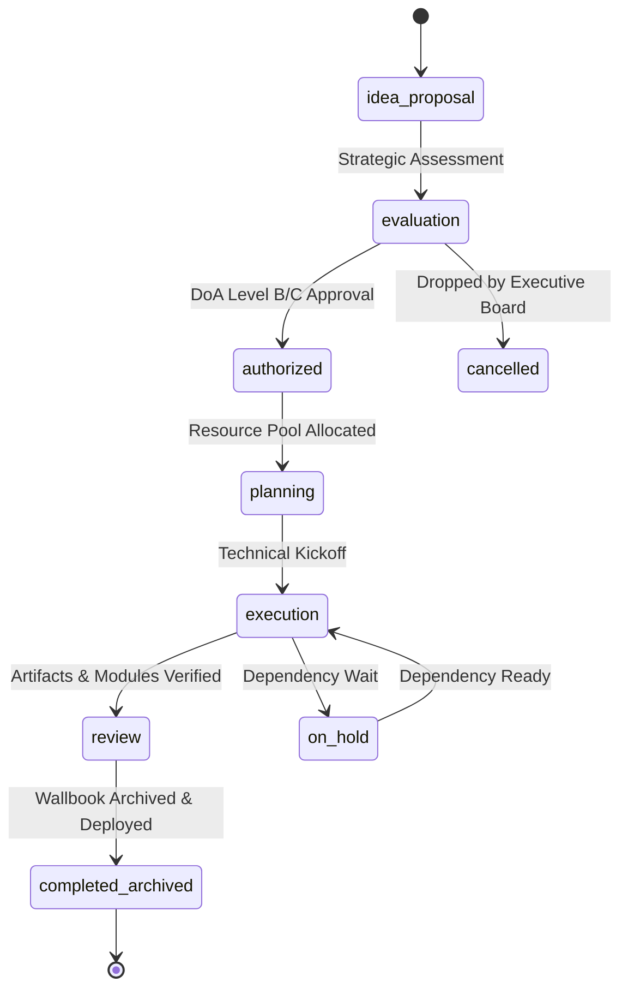

# MCE AI Office — Project Lifecycle State Machine Specification

**Document Version:** 1.0  
**Status:** Approved & Implemented  
**Author:** Senior Enterprise Project Management System Architect  
**Classification:** Operational Governance Architecture

---

## 1. Overview

The MCE Project Management Subsystem implements two distinct deterministic state machines:
1. **Customer Project Lifecycle (9 Stages):** Governs commercial delivery from lead inception to post-delivery warranty support.
2. **Internal Initiative Lifecycle (7 Stages):** Governs internal innovation, tooling pipelines, and platform R&D executed autonomously by the Continuous Executive Board within Delegated Authority boundaries.

Every state transition is validated by `ProjectLifecycleService` and recorded immutably in `project_status_history` and `project_audit_events`.

---

## 2. Customer Project Lifecycle State Machine

### 2.1 Stage Transition Rules & Gates (Customer Projects)

| Source Stage | Destination Stage | Required Entry Conditions & Gate Checks |
| :--- | :--- | :--- |
| `lead` | `qualification` | Client profile registered in `project_clients`; strategic fit verified. |
| `qualification` | `proposal` | Business objectives and proposed budget ceiling defined in `project_briefs`. |
| `proposal` | `contracted` | Commercial contract reference provided; approved budget limit set $>$ 0. |
| `contracted` | `planning` | Project manager (`project_manager_agent_id` or `user_id`) assigned; team allocated. |
| `planning` | `execution` | Formal scope baseline version marked active (`is_baseline = 1`); sprint schedule defined. |
| `execution` | `review_acceptance` | All critical path milestones achieved; all required deliverables submitted. |
| `review_acceptance` | `delivery_closure` | Zero open blocker issues; client formal acceptance recorded (`client_accepted = 1`). |
| `delivery_closure` | `warranty_support` | Final deliverables handed over; operational knowledge archived to Wallbook. |
| *Any Active Stage* | `on_hold` | Blocker issue escalated; work temporarily paused. |
| *Any Active Stage* | `cancelled` | Formal termination directive issued by Human Owner or client agreement. |

---

## 3. Internal Initiative Lifecycle State Machine

### 3.1 Stage Transition Rules & Gates (Internal Initiatives)

| Source Stage | Destination Stage | Required Entry Conditions & Gate Checks |
| :--- | :--- | :--- |
| `idea_proposal` | `evaluation` | Initiative brief documented; preliminary resource estimate proposed. |
| `evaluation` | `authorized` | **DoA Validation Gate:** Budget $\le$ IDR 5,000,000 auto-approved by Executive Board (Level B); budget $>$ IDR 5,000,000 requires Human Owner sign-off (Level A). |
| `authorized` | `planning` | Delivery lead assigned from AI Agent registry; milestone schedule configured. |
| `planning` | `execution` | Scope baseline registered; compute / agent runtime resource allocation created. |
| `execution` | `review` | Implementation modules delivered; automated test benchmarks passing 100%. |
| `review` | `completed_archived` | Zero open blocker issues; technical RFC and operation manual published to Wallbook. |
| *Any Active Stage* | `cancelled` | Invalidation of hypothesis or reprioritization by Executive Board. |

---

## 4. Status Transition Auditing

Every lifecycle transition automatically records:
- `project_id`: Target project identifier.
- `from_stage` and `to_stage`: Source and target stages.
- `from_status` and `to_status`: Operational status flags (`draft`, `active`, `on_hold`, `completed`, `cancelled`).
- `changed_by_user_id` / `changed_by_agent_id`: Entity initiating the transition.
- `reason`: Mandatory audit explanation justifying why the gate criteria were met.
- `notes`: Supplementary technical observations or reference links.
- `created_at`: Exact timestamp.
