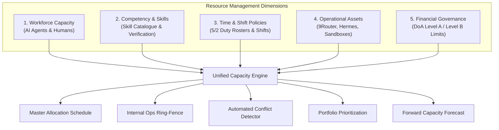

# Architectural Specification & Technical Blueprint
## Module: Resource & Capacity Planning, Portfolio Prioritization & Operational Allocation (Prompt 28)

**Document Code:** `MCE-ARCH-RES-2026-V1`  
**Classification:** Internal Architectural Standard  
**Author:** Senior Enterprise Resource Planning Architect & Systems Lead  
**Approved by:** Continuous Executive Board & Human Owner  
**Release Version:** `v0.13.0`  

---

## 1. Architectural Vision & Scope

The **Resource & Capacity Planning, Portfolio Prioritization & Operational Allocation Subsystem** constitutes the strategic and operational optimization plane of the **MCE AI Office**.

While Task Management (Prompt 21) governs discrete execution units and Project Management (Prompt 27) tracks client and initiative delivery lifecycle stages, this subsystem provides **enterprise-level resource balance, capacity forecasting, competency coverage, conflict resolution, and portfolio prioritization**.

### Core Tenets
1. **Zero Entity Duplication:** Workforce planning strictly binds to existing identities (`ai_agent_registry`, `users`) and task execution structures (`workforce_tasks`). It does NOT create duplicate agent/human models or parallel task engines.
2. **Policy Integrity (5/2 Work-Rest Cycle):** Standard weekly capacity is 40.00 hours (5 working days $\times$ 8.00 hours/day). Scheduled rest days, planned leave, and mandatory Wallbook handover intervals are non-negotiable boundaries.
3. **Internal Operations Protection (Continuous Board Ring-Fence):** Customer project demand must never consume 100% of workforce capacity. The Continuous Executive Board autonomously ring-fences 15%–30% capacity for internal platform R&D, bizdev solutioning, governance, and agent welfare cooldowns.
4. **Delegated Authority (DoA) Financial Ceilings:** Resource requests and asset procurements $\le$ IDR 5,000,000 are authorized autonomously by the Continuous Executive Board (DoA Level B); requests $>$ IDR 5,000,000 require Human Owner formal sign-off (DoA Level A).
5. **Truth in Forecasting:** All projected, estimated, or forward-looking models are explicitly segregated and tagged (`is_forecast_data = 1`), preventing synthetic numbers from being represented as actual performance.

---

## 2. Resource Management Conceptual Framework

The MCE AI Office defines resources across five foundational dimensions:



---

## 3. Mathematical Capacity & Utilization Model

### 3.1 Net Available Capacity Equation
$$\text{Available Capacity} = \text{Scheduled Capacity} - \text{Allocated Capacity} - \text{Reserved Capacity} - \text{Unavailable Capacity}$$

Where:
- $\text{Gross Capacity}$: Standard base capacity ($40.00\text{ hours/week}$).
- $\text{Unavailable Capacity}$: Time allocated to scheduled rest days ($16\text{h}$ per 7-day cycle), approved planned leave, or mandatory Wallbook handover cooldown periods.
- $\text{Scheduled Capacity} = \max(0, \text{Gross Capacity} - \text{Unavailable Capacity})$.
- $\text{Allocated Capacity}$: Total committed weekly hours from active project resource allocations (`resource_allocations_master`) and active tasks (`workforce_tasks`).
- $\text{Reserved Capacity}$: Ring-fenced weekly hours earmarked by the Continuous Executive Board (`resource_capacity_reservations`).
- $\text{Available Capacity} = \max(0, \text{Scheduled} - \text{Allocated} - \text{Reserved})$.

### 3.2 Workload Utilization Classification
$$\text{Utilization \%} = \frac{\text{Allocated Capacity} + \text{Reserved Capacity}}{\text{Scheduled Capacity}} \times 100$$

| Utilization Range | Classification | System Behavioral Response |
| :--- | :--- | :--- |
| $< 50.00\%$ | `underutilized` | Candidate for new project intake or internal R&D assignment. |
| $50.00\% - 85.00\%$ | `balanced` | Optimal operational zone. High quality, zero fatigue risk. |
| $85.01\% - 100.00\%$ | `high_utilization` | Monitored zone. New task assignments require caution. |
| $> 100.00\%$ | `overallocated` | Triggers operational warning/conflict; blocks unapproved assignments. |
| $\text{Scheduled} = 0$ | `unavailable` | Off-duty, scheduled rest, or approved planned leave. |

---

## 4. Multi-Criteria Portfolio Prioritization Model

To optimize resource allocation across competing customer projects and internal initiatives, MCE utilizes a mathematical multi-factor scoring engine:

$$\text{Composite Score} = (0.25 \times S) + (0.25 \times C) + (0.20 \times V) + (0.15 \times U) + (0.15 \times F) - (0.10 \times R)$$

Where:
- $S \in [0, 100]$: **Strategic Alignment** (alignment with MCE long-term mission and platform autonomy).
- $C \in [0, 100]$: **Customer Commitment** (contractual SLAs, revenue milestone criticality).
- $V \in [0, 100]$: **Business Value** (financial margin, strategic market presence).
- $U \in [0, 100]$: **Urgency** (timeline sensitivity, delivery deadlines).
- $F \in [0, 100]$: **Technical Feasibility** (competency availability, runtime readiness).
- $R \in [0, 100]$: **Risk Penalty** (delivery complexity, dependencies, compliance risk).

### Priority Tiers
- **Tier 1 Critical ($\ge 80.00$):** Guaranteed resource allocation; protected from displacement.
- **Tier 2 High ($65.00 - 79.99$):** Standard project execution priority.
- **Tier 3 Medium ($50.00 - 64.99$):** Secondary initiatives; executed when capacity allows.
- **Tier 4 Deferrable ($< 50.00$):** Deferred until capacity surplus exists.

---

## 5. Automated Conflict Detection Architecture

The `ResourceConflictService` continuously scans operational state for five critical collision types:
1. **Overallocation Conflict:** Total committed hours exceed 40.00h/week or $>100\%$ utilization.
2. **Rest Day Conflict:** Assigning project tasks or duty during scheduled 5/2 rest periods.
3. **Skill Mismatch Conflict:** Assigning an agent lacking required competency certification or below required proficiency tier.
4. **Missing Replacement Conflict:** Off-duty transition initiated without designated qualified replacement.
5. **Resource Maintenance Outage:** Operational asset set to `maintenance` status while committed to active project allocations.

---

## 6. Database Relational Topology (Migration Batch 13)

```
+------------------------------------+       +------------------------------------+
|         resource_registry          |       |   resource_capacity_reservations   |
| (Tools, Compute, 9Router, Env)     |       | (Internal Ops Ring-Fence)          |
+------------------------------------+       +------------------------------------+
                  ^                                            ^
                  |                                            |
+------------------------------------+       +------------------------------------+
|         resource_requests          | ----> |     resource_allocations_master    |
| (Workflow & DoA Approval Routing)  |       | (Master Schedule Binding Work)     |
+------------------------------------+       +------------------------------------+
                  |                                            |
                  v                                            v
+------------------------------------+       +------------------------------------+
|         resource_conflicts         |       |        portfolio_priorities        |
| (Collision & Overallocation Alerts)|       | (Multi-Criteria Project Rankings)  |
+------------------------------------+       +------------------------------------+
                  |
                  v
+------------------------------------+       +------------------------------------+
|    capacity_forecast_snapshots     |       |       capacity_gap_analyses        |
| (Demand vs Supply 4-Week Projection|       | (Skill Deficits & Training Plans)  |
+------------------------------------+       +------------------------------------+
```
