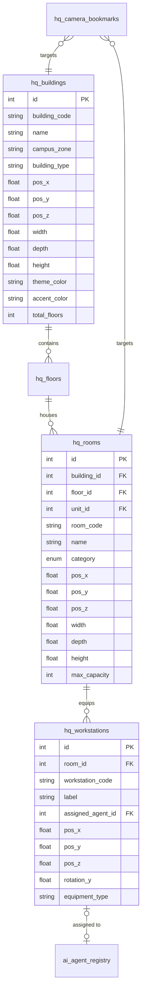

# Virtual Headquarters (VHQ) Spatial Architecture

## 1. Executive Summary

The **Virtual Headquarters (VHQ)** of Mitra Creative Environment (MCE) serves as the primary visual and spatial operations cockpit for the autonomous AI workforce. Built on a coordinate-based data-driven model, every physical building, floor, room, and desk is persisted in relational database tables and rendered deterministically in real-time.

```
+---------------------------------------------------------------------------------------------------+
|                                 MCE VIRTUAL HEADQUARTERS CAMPUS                                   |
|                                                                                                   |
|      [BLD-DIV-ACAD]                                                          [BLD-DIV-HW]         |
|   Academy Center (-28, -26)                                               Hardware Labs (28, -26) |
|            \                                                                     /                |
|             \                       [BLD-MAIN]                                  /                 |
|              \              Main Executive Tower (0, -10)                      /                  |
|               \             - Boardroom (Exec Level)                          /                   |
|                \            - Director AI Suite                              /                    |
|                 \           - Central Telemetry                             /                     |
|                  \                           |                             /                      |
|      [BLD-DIV-TECH]                          |                               [BLD-DIV-SRV]        |
|    Tech Pavilion (-28, 6) ------- [CAMPUS PLAZA & FOUNTAIN] (0, 0) ------- Services Pavilion (28, 6) |
|                                              |                                                    |
|                                              |                                                    |
|                                     [BLD-WELFARE]                                                 |
|                             AI Agent Welfare Commons (0, 24)                                      |
|                             - Recovery Pods Alpha & Beta                                          |
|                             - Knowledge Enrichment Lounge                                         |
+---------------------------------------------------------------------------------------------------+
```

---

## 2. Coordinate Reference System (CRS)

The VHQ coordinate system uses a right-handed Three.js Cartesian coordinate system:
- **X-axis**: East-West axis (Negative = West / Technology & Academy; Positive = East / Services & Hardware).
- **Y-axis**: Vertical elevation (0.0 = Campus ground; 0.45 = First floor interior; 5.5 = Second floor).
- **Z-axis**: North-South axis (Negative = North / Main Executive Tower; Positive = South / AI Welfare Commons).

### Campus Building Master Layout

| Building Code | Building Name | Zone | Type | Coordinates (X, Y, Z) | Dimensions (W x D x H) | Floors | Theme / Accent Color |
|---|---|---|---|---|---|---|---|
| `BLD-MAIN` | Main Campus & Executive Tower | `executive_core` | `tower` | `(0.0, 0.0, -10.0)` | `24.0 x 18.0 x 14.0` | 2 | `#0f172a` / `#38bdf8` |
| `BLD-DIV-TECH` | Technology & AI Solutions Pavilion | `technology_wing` | `pavilion` | `(-28.0, 0.0, 6.0)` | `20.0 x 16.0 x 8.0` | 1 | `#1e1b4b` / `#6366f1` |
| `BLD-DIV-SRV` | Creative & Enterprise Services Pavilion | `services_pavilion` | `pavilion` | `(28.0, 0.0, 6.0)` | `20.0 x 16.0 x 8.0` | 1 | `#064e3b` / `#10b981` |
| `BLD-DIV-ACAD` | Training & Academy Innovation Center | `academy_center` | `hall` | `(-28.0, 0.0, -26.0)` | `18.0 x 15.0 x 7.5` | 1 | `#451a03` / `#f59e0b` |
| `BLD-DIV-HW` | Advanced Hardware & Infrastructure Facility | `hardware_labs` | `facility` | `(28.0, 0.0, -26.0)` | `18.0 x 15.0 x 7.5` | 1 | `#3f3f46` / `#ef4444` |
| `BLD-WELFARE` | AI Agent Welfare Commons | `welfare_commons` | `welfare_center` | `(0.0, 0.0, 24.0)` | `22.0 x 16.0 x 7.0` | 1 | `#14532d` / `#34d399` |

---

## 3. Relational Spatial Data Schema

Spatial relationships are stored across five authoritative tables in MySQL (`mce_db`):



---

## 4. Workforce Workstation Mappings

Workstations are mapped to verified enterprise AI agents with single-desk data integrity:

| Workstation Code | Room Code | Building | Assigned Agent | Equipment Type |
|---|---|---|---|---|
| `WS-DIR-01` | `ROOM-DIR-SUITE` | `BLD-MAIN` | `AGT-DIR-001` (Director AI) | Executive Desk |
| `WS-TECH-LEAD` | `ROOM-TECH-DEV` | `BLD-DIV-TECH` | `AGT-TECH-001` (Tech Head AI) | Dual Monitor Coding Station |
| `WS-TECH-DEV01` | `ROOM-TECH-DEV` | `BLD-DIV-TECH` | `AGT-DEV-001` (Dev AI) | Dual Monitor Coding Station |
| `WS-SRV-LEAD` | `ROOM-SRV-STUDIO` | `BLD-DIV-SRV` | `AGT-SRV-001` (Services Head AI) | Standard Studio Desk |
| `WS-ACAD-LEAD` | `ROOM-ACAD-HALL` | `BLD-DIV-ACAD` | `AGT-ACD-001` (Academy Head AI) | Curriculum Terminal |
| `WS-HW-LEAD` | `ROOM-HW-LAB` | `BLD-DIV-HW` | `AGT-HDW-001` (Hardware Head AI) | Monitoring Telemetry Console |
| `WS-WLF-POD01` | `ROOM-WLF-REST` | `BLD-WELFARE` | *(Unassigned / Rest Pod Alpha)* | Welfare Pod |
| `WS-WLF-POD02` | `ROOM-WLF-REST` | `BLD-WELFARE` | *(Unassigned / Rest Pod Beta)* | Welfare Pod |
