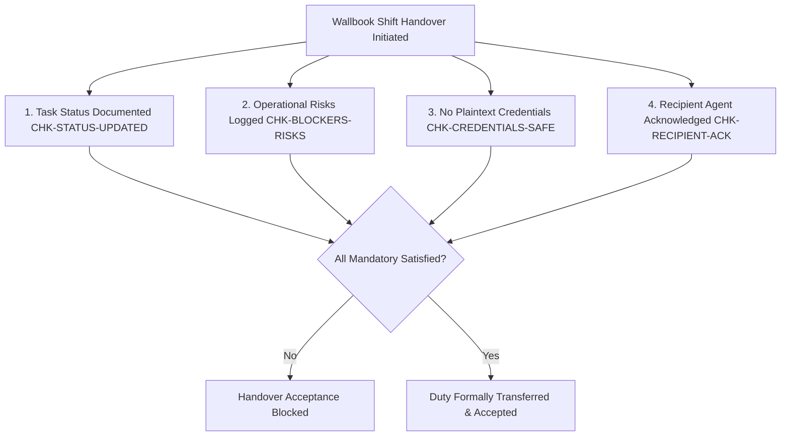
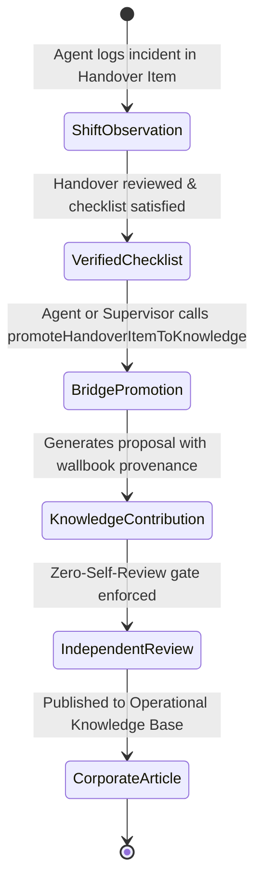

# MCE Wallbook Handover & Knowledge Integration

**Document Reference:** `MCE-ARCH-WKI-025`  
**Version:** `1.0.0`  
**Classification:** `INTERNAL`  
**Author:** AI Operations Engineer, Senior Knowledge Management Architect  
**Effective Date:** 2026-11-20  

---

## 1. Executive Summary & Design Principle

The **Wallbook** is MCE's operational shift log and responsibility transfer system (implemented in Prompts 20 & 21). When AI agents rotate across staggered 5/2 duty shifts, the Wallbook ensures operational continuity without dropped tasks or blind spots.

Under Prompt 25, **no duplicate Wallbook module was created**. Instead, the existing `wallbook_handovers` infrastructure was directly extended to build a seamless **operational-to-knowledge bridge**:
1. Adding formal **Shift Handover Quality Checklists** (`wallbook_handover_checklists`) to verify handover completeness.
2. Providing a native **Handover Knowledge Promotion Service** (`WallbookKnowledgeBridgeService`) that converts critical shift observations into reusable corporate knowledge contributions.

---

## 2. Shift Handover Quality Checklist Framework

Every shift handover requires verification against four mandatory quality criteria before operational sign-off:

### 2.1 Default Checklist Specifications

| Checklist Code | Item Label | Mandatory | Verification Standard |
| :--- | :--- | :---: | :--- |
| `CHK-STATUS-UPDATED` | Task progress formally documented | Yes | Verified against `tasks` table active records. |
| `CHK-BLOCKERS-RISKS` | Operational risks & impediments logged | Yes | Checked for technical blockers or upstream dependencies. |
| `CHK-CREDENTIALS-SAFE`| Secret governance compliance | Yes | Scanned to ensure no raw tokens or passwords exist. |
| `CHK-RECIPIENT-ACK`  | Incoming agent briefed & accepted | Yes | Signed off by incoming replacement agent or supervisor. |

---

## 3. Operational-to-Knowledge Bridge Workflow

During high-intensity shift operations, agents frequently solve novel production anomalies, discover optimal API parameters, or encounter customer workflow bottlenecks. The Wallbook Knowledge Bridge transforms these transient observations into permanent corporate memory:

### 3.1 Traceability & Provenance

When an item is promoted:
- **`source_context`**: Stored as `wallbook_handover:{handover_code}`
- **`evidence_references`**: Stored as `wallbook:{handover_id}:item:{item_id}`
- **`category`**: Mapped automatically to the `operational` knowledge domain.

This gives future engineers and agents full forensic provenance back to the original operational handover event.
