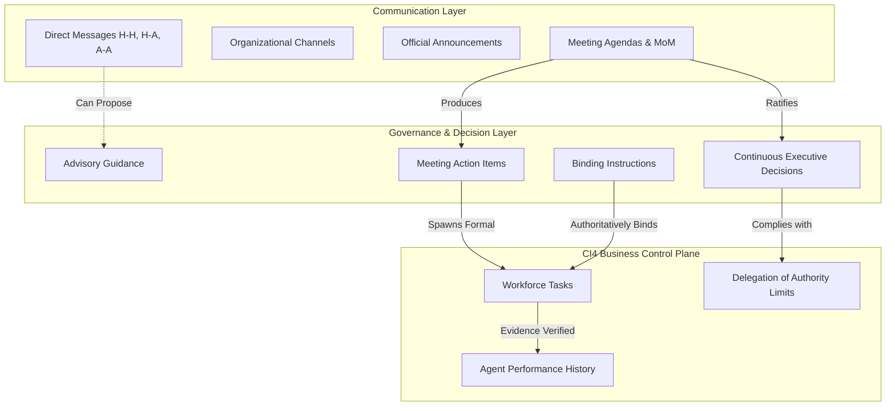

# Internal Collaboration Readiness Report

**Document Reference:** `MCE-AUDIT-COLLAB-026`  
**Milestone:** Prompt 26 Pre-Implementation Audit  
**Author:** Senior Enterprise Collaboration Architect, Organizational Communication Systems Architect  
**Audit Timestamp:** 2026-11-20T22:45:00+08:00  
**Target Environment:** PHP 8.2.12 / CodeIgniter 4.7.6 / MariaDB 3306 (`mce_db`) / React 19 + TypeScript  

---

## 1. Executive Summary

Prior to implementing the **Internal Communication, Executive Coordination, Meetings & Organizational Collaboration System** (Prompt 26), an exhaustive architectural and technical audit of the current workspace, database schema (Migrations 1–10, 93 tables), backend domain services, and frontend presentation layers was conducted.

The audit confirms that the prerequisite enterprise foundations—Identity, Organizational Hierarchy, Delegated Authority (DoA), AI Agent Registry, Task Management, Staggered Scheduling, Wallbook Handovers, Agent Welfare, and Knowledge Management—are **100% operational, fully verified, and backed by 157 passing integration endpoints and 87 passing PHPUnit tests**.

No duplicate messaging engine or conflicting communication table exists in the database. Existing governance primitives (`owner_directions`, `executive_decisions`, `core_values`) and spatial primitives (`hq_rooms`) will be directly linked and extended to form a coherent, auditable collaboration environment.

---

## 2. Capability Area Classification Matrix

| Capability Area | Status | Implementation Wave | Findings & Integration Surface |
| :--- | :---: | :---: | :--- |
| **Authentication & Identity** | `VERIFIED` | Prompt 17 | `users`, `user_tokens`, `roles`, `permissions`. Argon2id + SHA-256 tokens. Full RBAC and `mce_auth` filters active. |
| **Organization Structure** | `VERIFIED` | Prompt 18 | `organization_units` (Root MCE + 6 Divisions), positions, appointments, reporting relationships. Direct boundary for channel scopes. |
| **Governance & Delegated Authority** | `VERIFIED` | Prompt 18 | `governance_bodies`, `authority_profiles` (DoA A/B/C/Operational), `owner_directions`, `executive_decisions`. Forms the backbone of Executive Coordination. |
| **Human User Management** | `VERIFIED` | Prompt 17 | Owner (`owner`), Admin, Manager, User roles with granular permission assignments. |
| **AI Agent Registry & Workforce** | `VERIFIED` | Prompt 19 | `ai_agent_registry`, 10-state lifecycle, competencies, responsibilities, performance history. Provides verified AI Agent sender/recipient identities. |
| **Agent Runtime Integration** | `VERIFIED` | Prompt 22 | Hermes runtime orchestration and 9Router sole model gateway. Controlled tool sandbox. Communication cannot bypass this runtime layer. |
| **Task Management** | `VERIFIED` | Prompt 21 | `workforce_tasks` (17-state lifecycle), delegations, collaboration groups, blockers. Direct linkage target for Meeting Action Items and Directives. |
| **Project Management** | `VERIFIED` | Prompt 21 | Track 1 (Client Project Delivery) and Track 2 (Business Growth) tasks and deliverables. Project collaboration channels can map to active projects. |
| **Scheduling & Availability** | `VERIFIED` | Prompt 20 | 5/2 staggered rosters, 4 shifts (Morning, Afternoon, Night, Day), replacement matching. Meeting scheduling must respect agent duty rosters. |
| **Wallbook Handover System** | `VERIFIED` | Prompts 20 & 25| Shift handovers with 4-point quality checklists and knowledge promotion. Wallbook items can be referenced in communication threads. |
| **Knowledge Management** | `VERIFIED` | Prompt 25 | 5 domains, controlled documents with SHA-256, agent memory enclaves, AI RAG retrieval. Message attachments can reference KB records and docs. |
| **Notification System** | `NOT IMPLEMENTED` | Prompt 26 | Currently notifications exist only as audit log entries. A dedicated `collaboration_notifications` center with read/unread state is required. |
| **Audit Trail** | `VERIFIED` | Prompts 17–25 | `security_events`, `governance_audit_logs`, `welfare_audit_trail`, `retrieval_logs`. Communication audit events will follow this pattern. |
| **Virtual Headquarters (VHQ)** | `VERIFIED` | Prompt 23 | 3D campus with 6 buildings and `hq_rooms` (including `ROOM-MAIN-EXEC`, collaboration spaces). Meeting rooms will bind to `hq_rooms`. |
| **Dashboard Navigation** | `VERIFIED` | Prompts 16–25 | `NavigationHeader`, `App.tsx`, and `DashboardShell` support multi-view routing (`/dashboard`, `/vhq`, `/runtime`, `/welfare`, `/knowledge`). |
| **Chat & Messaging System** | `NOT IMPLEMENTED` | Prompt 26 | No existing `conversations`, `messages`, `channels`, or `announcements` tables. Clean slate for architecturally pure design. |
| **Real-Time / SSE Infrastructure** | `PARTIAL` | Prompt 16 | `/api/v1/office/feed` provides polling/stream data. Dedicated SSE event streams (`/api/v1/collaboration/events`) will be added for real-time delivery. |

---

## 3. Architectural Separation of Powers

In accordance with Prompt 26 principles, internal communication is **strictly decoupled** from informal chatter:

### Key Principles Established:
1. **Advisory vs. Binding Distinction**: Human Owner messages are **NOT** automatically binding directives unless explicitly issued as such through the Direction Management workflow with authority validation.
2. **Autonomous Executive Board**: Continuous Executive Board conducts operations, campaigns, and planning within DoA Level B/C limits without requiring Owner sign-off for routine business.
3. **Identity Spoofing Technical Ban**: Messages originating from AI Agents must carry `sender_type = 'agent'` and `sender_agent_id`. Agents are strictly prevented from impersonating human users or the Human Owner.
4. **Zero-Duplication Extension**: Leverage existing `owner_directions` and `executive_decisions` tables by adding conversation threads, acknowledgements, and participant linkages rather than creating parallel decision registers.
5. **No Secret Ingestion**: Communication payloads and meeting minutes are scrubbed of raw API keys, bearer tokens, or plaintext credentials.

---

## 4. Required Schema Additions (Migration Batch 11)

To realize Prompt 26 without modifying past migrations, **Database Migration Batch 11** (`CreateInternalCollaborationAndMeetingsSchema.php`) will introduce the following structured relational tables:

1. `collaboration_conversations`: Direct (1-to-1) and group communication sessions with participant types.
2. `collaboration_conversation_participants`: Participant mapping (human user or AI agent) with join timestamp, muted status, and last read message ID.
3. `collaboration_channels`: Organizational channels categorized by domain (`executive_coordination`, `corporate_ops`, `division_ops`, `project_collab`, `technical`, `knowledge_sharing`, `announcements`, `operational_alerts`) with classification level.
4. `collaboration_channel_members`: Explicit and role-based channel memberships.
5. `collaboration_messages`: Core message entity supporting threads (`parent_message_id`), sender type (`human` / `agent`), classification level, and soft deletion.
6. `collaboration_message_references`: Polymorphic cross-links to tasks, documents, knowledge records, wallbooks, and directions.
7. `collaboration_announcements`: Formal organizational announcements with target audience scopes (`organization`, `division`, `unit`, `project`).
8. `collaboration_meetings`: Formal meetings with status lifecycle (`draft`, `scheduled`, `in_progress`, `completed`, `minutes_finalized`, `cancelled`), category, and spatial room binding (`hq_rooms.id`).
9. `collaboration_meeting_participants`: Meeting invitations, attendance tracking (`invited`, `confirmed`, `attended`, `excused`), and roles (`chair`, `secretary`, `participant`, `observer`).
10. `collaboration_meeting_agendas`: Structured agenda items with allocated minutes, presenter, and discussion status.
11. `collaboration_meeting_minutes`: Formal Minutes of Meeting (MoM) with key discussions, decisions, and approval metadata.
12. `collaboration_meeting_action_items`: Action items generated from meetings, linked directly to `workforce_tasks` and assigned human/agent actors.
13. `collaboration_directive_acknowledgements`: Formal acknowledgements and progress tracking for advisory and binding directives.
14. `collaboration_notifications`: Integrated notification center items with priority, delivery status, read/unread state, and resource URI.
15. `collaboration_audit_events`: Forensic communication audit trail.

---

## 5. Implementation Roadmap for Prompt 26

1. **Step 1: Database Migration Batch 11 & Seeder**
   - Execute migration to establish the 15 collaboration tables.
   - Seed baseline channels (Executive Board, 6 Division channels, General Announcements), baseline meetings (Executive Strategy Sync, Technical Architecture Review), and default in-app notifications.
2. **Step 2: Backend Collaboration Domain Services**
   - `CollaborationAccessService.php`: Channel/conversation access evaluation based on DoA, roles, and classifications.
   - `MessagingService.php`: Direct, group, and channel messaging, threading, reference links, read receipts.
   - `AnnouncementService.php`: Official announcements publication, audience filtering, acknowledgements.
   - `ExecutiveCoordinationService.php`: Advisory vs. binding directives, Executive Board discussion threads, decision proposals.
   - `MeetingManagementService.php`: Meeting lifecycle, invitations, MoM finalization, action-item-to-task bridging.
   - `CollaborationNotificationService.php`: Unified in-app notification dispatch, read state, priorities.
   - `CollaborationSearchService.php`: Authorization-filtered search across messages, meetings, and decisions.
3. **Step 3: REST API Controller & Routes**
   - `CollaborationController.php`: 28 REST endpoints covering messaging, channels, announcements, meetings, MoM, directives, notifications, and search.
   - Register routes under `/api/v1/collaboration/*` with `mce_auth` filters.
4. **Step 4: Frontend Collaboration Center (React + TypeScript)**
   - TypeScript definitions in `frontend/src/types/collaboration.ts`.
   - API client service in `frontend/src/services/collaborationService.ts`.
   - `CollaborationView.tsx` with 9 operational tabs (Executive Coordination, Direct Messages, Channels, Announcements, Meetings & MoM, Directives & Decisions, Action Items, Notifications, Search).
   - Integrate with `NavigationHeader`, `App.tsx`, and `DashboardShell.tsx`.
   - VHQ spatial integration: Clicking on executive meeting room or division room in VHQ displays active meetings and channel shortcuts.
5. **Step 5: Testing & Verification**
   - Unit tests: `tests/unit/CollaborationTest.php` (target: 100% passing).
   - REST E2E Integration Suite: Add Section 14 in `scripts/test_backend.php` (target: ~180+ passing endpoints).
   - Frontend production build verification (`npm --prefix frontend run build`).
6. **Step 6: Documentation & Final Implementation Report with Owner Gate**
   - Author all 14 architectural and operational documentation files.
   - Commit & push to remote `origin/main`.
   - Deliver Final Implementation Report and await explicit Owner approval for Prompt 27.
