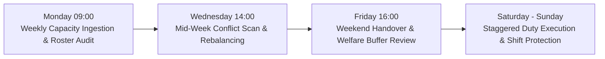

# Operations & Capacity Management Runbook
## Standard Operating Procedures: Resource & Capacity Planning, Conflict Resolution & Portfolio Prioritization

**Document Code:** `MCE-SOP-RES-2026-V1`  
**Classification:** Operational Runbook  
**Applicability:** Continuous Executive Board, Division Leads, Operational Planners  
**System Version:** `v0.13.0`  

---

## 1. Purpose & Operational Mandate

This standard operating procedure defines the daily and weekly cadence for managing the **MCE AI Office** resource inventory, workforce capacity, internal operations ring-fencing, and portfolio priorities.

The overarching goal is to maintain high-velocity client delivery while strictly preventing AI Agent overallocation, protecting mandatory 5/2 rest cycles, preserving internal platform development, and respecting Delegated Authority (DoA) financial limits.

---

## 2. Weekly Operational Planning Cadence

### 2.1 Monday Morning: Capacity Ingestion & Review (09:00 UTC+7)
1. **Access Resource Planning Dashboard:** Navigate to `/#resources` in the MCE AI Office console.
2. **Review Divisional Utilization:** Verify that no division exceeds $85\%$ aggregate utilization.
   - If any division exceeds $85\%$, review open task assignments and active projects in that unit.
3. **Verify 5/2 Roster Compliance:** Ensure every active agent has exactly 5 scheduled duty days (40.00h) and 2 designated rest days (16.00h).
4. **Inspect Internal Ops Ring-Fence:** Confirm that Continuous Executive Board reservations (`resource_capacity_reservations`) earmark between 15% and 25% capacity for platform R&D and bizdev.

### 2.2 Wednesday Mid-Week: Conflict Scan & Rebalancing (14:00 UTC+7)
1. **Execute Automated Conflict Scan:** Click **⚡ Scan Conflicts Now** or invoke `POST /api/v1/resource-planning/conflicts/detect`.
2. **Evaluate Detected Collisions:**
   - **Critical (Red):** Scheduled rest day collisions or operational assets in maintenance with active commitments. Must be resolved immediately.
   - **Warning (Yellow):** Agent utilization $>100\%$ or minor skill proficiency variances.
3. **Resolve Conflicts:**
   - Open the Conflict Center modal.
   - Assign qualified replacement agent or reassign secondary tasks.
   - Input operational resolution notes and mark `Resolved`.

### 2.3 Friday Afternoon: Weekend Coverage & Welfare Alignment (16:00 UTC+7)
1. **Verify Weekend Duty Roster:** Confirm that weekend coverage agents (`dev_ai` and `academy_head` under staggered shift policies) are active and ready.
2. **Audit Wallbook Handover Status:** Ensure mandatory handover checklists are completed prior to off-duty transitions.
3. **Check Operational Tool Health:** Confirm that 9Router Model Gateway pools and Hermes node clusters have sufficient available capacity for unattended weekend automated runs.

---

## 3. SOP: Ring-Fencing Internal Operations Capacity

### Context
Commercial project intake creates natural pressure to commit 100% of workforce capacity to billable client work. The Continuous Executive Board has permanent authority to ring-fence internal capacity to protect long-term MCE health.

### Procedure
1. Navigate to **🛡️ Internal Ops Ring-Fence** sub-tab in `/#resources`.
2. Click **+ Ring-Fence Capacity**.
3. Select appropriate Reservation Type:
   - `internal_operations`: Corporate governance and leadership duties.
   - `platform_rnd`: Hermes runtime tooling and 9Router optimization.
   - `bizdev_growth`: Solution engineering for incoming client inquiries.
   - `agent_welfare_buffer`: Wallbook handover and cooldown buffer.
4. Set Reserved Percentage (typically 10%–25%) and Hours per Week (typically 4h–10h).
5. Input strategic justification and click **Activate Reservation**.

---

## 4. SOP: Reviewing and Approving Resource Requests

### Context
When a Project Manager or Division Lead requires additional agent capacity or compute assets for a project milestone, they must submit a formal `resource_request`.

### Procedure
1. Navigate to **📝 Requests & Allocation** sub-tab.
2. Review request details, hours requested, and estimated cost:
   - **DoA Level B ($\le$ IDR 5,000,000):** Continuous Executive Board can approve autonomously.
   - **DoA Level A ($>$ IDR 5,000,000):** Requires Human Owner explicit digital sign-off.
3. Click **Assess Capacity** to trigger the automated supply check:
   - Evaluates if qualified agents or tools have sufficient available capacity.
4. If capacity is sufficient, click **Approve**.
5. Once approved, click **Allocate** to create the official master schedule binding in `resource_allocations_master`.

---

## 5. SOP: Managing Single Points of Failure (SPOF) & Competency Deficits

### Context
When a critical skill is only mastered by one active agent, any unavailability of that agent halts dependent projects.

### Procedure
1. Navigate to **🎯 Skill Coverage & SPOF** sub-tab.
2. Review **SPOF ALERT** competencies:
   - Identify the sole qualified agent.
   - Identify candidate agents in the same division with adjacent foundational skills.
3. Initiate cross-training or peer-pairing:
   - Pair candidate agent as observer on current tasks.
   - Submit formal competency verification request once proficiency criteria are met.
4. Review **Critical Competency Bottlenecks**:
   - If deficit exceeds 20h/week, evaluate shift schedule adjustments or request provisioning of a new specialist agent.

---

## 6. Emergency Workload Rebalancing Protocol

In the event of an unplanned agent offline status or sudden milestone deadline acceleration:
1. Planners must NEVER increase an agent's weekly hours beyond 45.00 hours.
2. Planners must NEVER cancel a scheduled 5/2 rest cycle without activating an approved replacement.
3. Planners should temporarily reduce internal R&D capacity reservations (within DoA Level B limits) to release emergency capacity for critical customer deliveries.
4. All emergency overrides must be logged with formal justification in the Resource Audit Trail.
